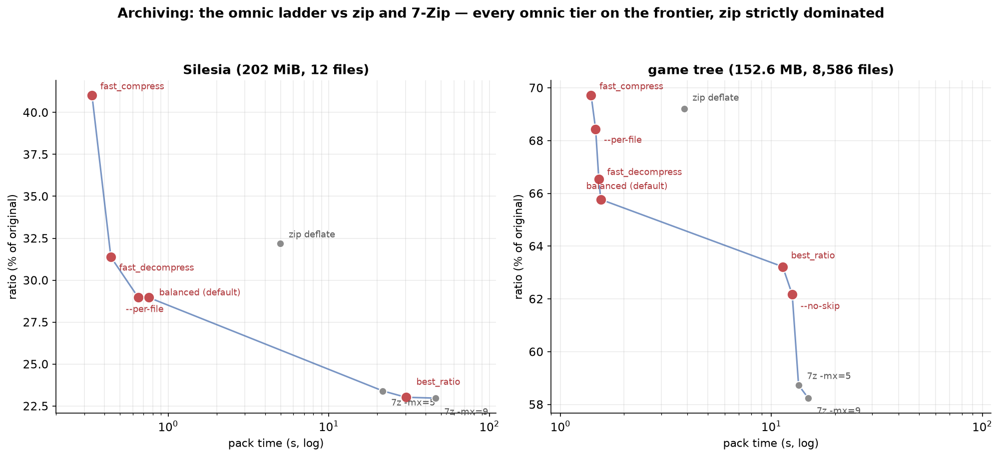
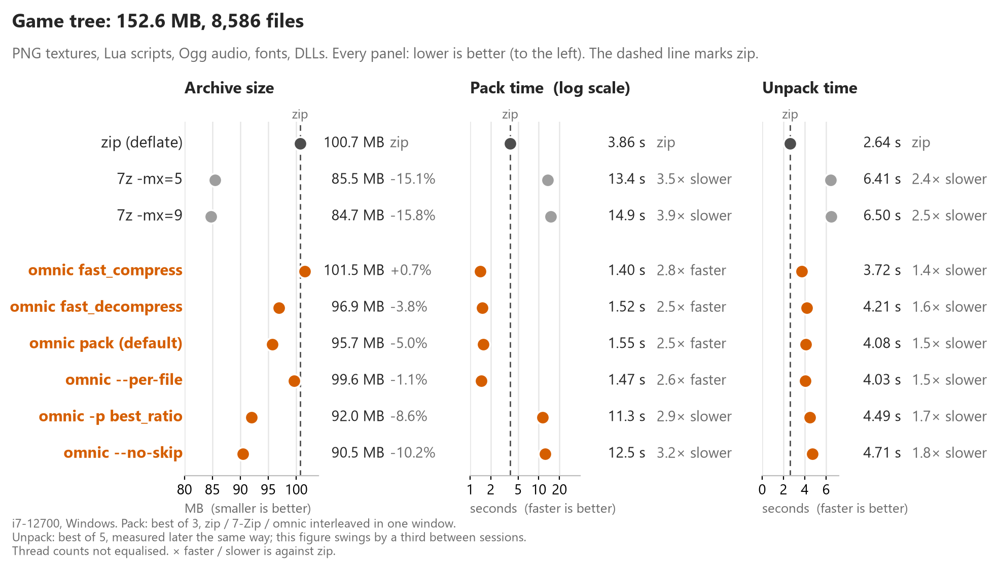
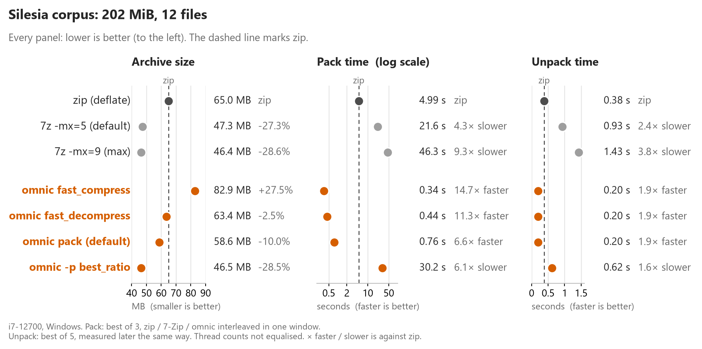
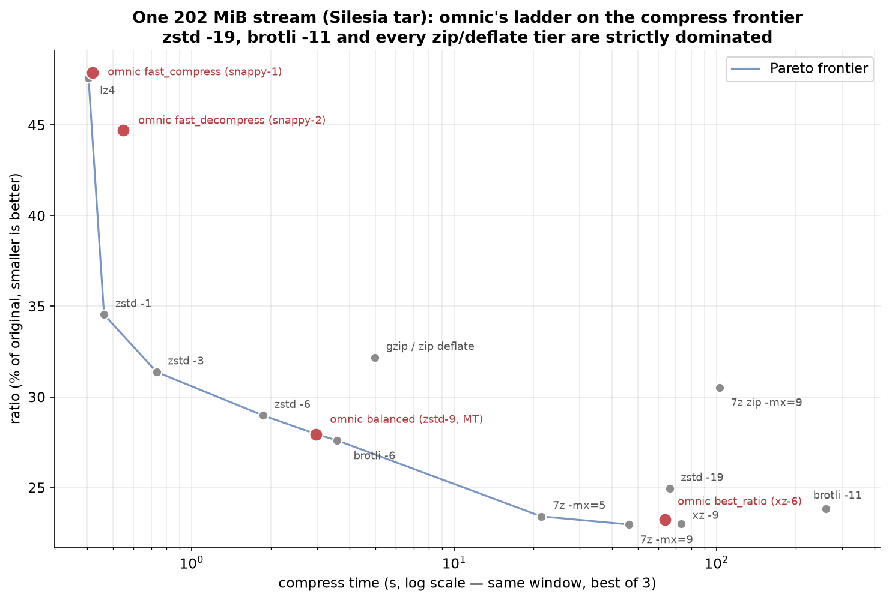
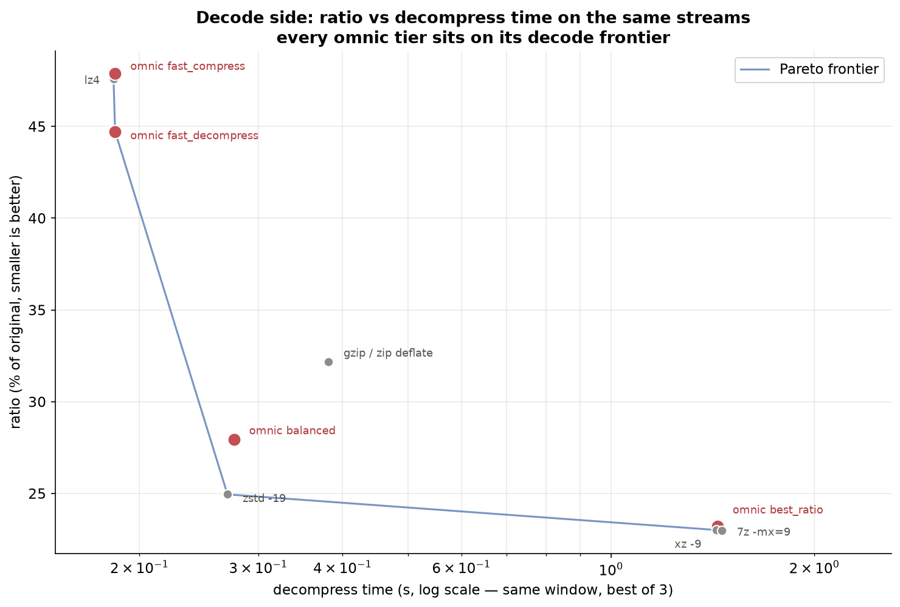
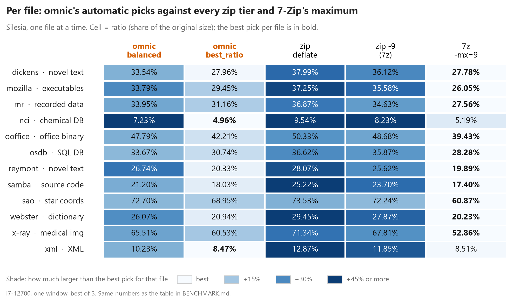

# omnic benchmark

All numbers are measured, same machine (i7-12700, Windows, NVMe SSD), same
window — omnic, 7-Zip 26.06 and the system tar (bsdtar) interleaved in one
session. The archive numbers are the ones behind the [README](README.md)'s
charts and its collapsed raw-number tables (this page adds a few rows and a
column), and this page also carries the single-stream, per-file and Kraken
tables. Methodology at the bottom.



## Archives — game tree, every zip tier

The same 152.6 MB game tree (8,586 files — PNG textures, Lua scripts, Ogg
audio, models, fonts, DLLs):



| option | ratio | archive size | vs zip | pack | full unpack | single-file extract |
|---|---|---|---|---|---|---|
| zip (deflate default) | 69.20% | 100.7 MB | — | 3.86 s | 2.64 s | 26.9 ms |
| zip -9 (deflate max, 7z encoder) | 67.97% | 99.0 MB | -1.8% | 6.35 s | — | 26.2 ms |
| **omnic pack** (solid, default) | **65.77%** | **95.7 MB** | **-5.0%** | **1.55 s** | 4.08 s | 54 ms |
| omnic pack --per-file | 68.43% | 99.6 MB | -1.1% | 1.47 s | 4.03 s | **8.8 ms** |
| omnic pack --per-file -p best_ratio | 66.44% | 96.7 MB | -4.0% | 5.9 s | — | **8.9 ms** |
| omnic pack -p best_ratio | 63.22% | 92.0 MB | -8.6% | 11.3 s | 4.49 s | 201 ms |
| omnic pack --no-skip | **62.17%** | **90.5 MB** | **-10.2%** | 12.5 s | 4.71 s | 54 ms |

- **Smaller and faster at the default tier**: -5.0% size at 40% of the pack time.
- **Single-file extraction is the per-file tier's game**: 8.8 ms (process start
  included) vs 26.9 ms for the fastest zip tool we could find (bsdtar) — 3×.
  The honest cost of solid mode: extracting from an xz block decodes the whole
  64 MiB block (201 ms for best_ratio); zip seeks instead. Use `--per-file`
  when member latency matters.
- **The ratio ceiling**: --no-skip at -10.2% vs zip, where deflate simply
  cannot follow (it caps at 68.0% even at its max).
- 7-Zip is the one ahead here: `7z -mx=9` reaches 58.24% (84.7 MB, 14.9 s),
  `7z -mx=5` 58.73% (85.5 MB, 13.4 s) — 5 pp smaller than omnic's `best_ratio`.

## Archives — Silesia against 7-Zip's maximum

Silesia (the standard 202 MiB, 12-domain corpus — novels, dictionary,
chemistry database, C source, medical/X-ray images, binaries, XML; no file
extensions, so every decision goes through content sampling):



| option | ratio | pack | unpack |
|---|---|---|---|
| **omnic default (balanced)** | 28.97% | **0.76 s** | **0.20 s** |
| 7z -mx=5 (its default) | 23.40% | 21.6 s | 0.93 s |
| **omnic -p best_ratio** | 23.02% | **30.2 s** | **0.62 s** |
| 7z -mx=9 (its max) | **22.97%** | 46.3 s | 1.43 s |

Default tiers are different animals (omnic's is a speed tier, 28× faster and
5.6 pp larger). At the max tier they tie on ratio to 0.05 pp — and omnic is
the faster one by 1.5×: block compression runs through a worker pool while a
single 7z stream serializes LZMA2. It unpacks 2.3× faster as well (0.62 s
against 1.43 s).

Cross-corpus vs zip on Silesia: balanced is 3.2 pp smaller, 6.6× faster to
pack, and 1.9× faster to unpack (28.97% / 0.76 s vs 32.18% / 4.99 s;
unpack 0.20 s vs 0.38 s).

## One stream, every compressor: the Pareto picture

The 202 MiB Silesia corpus as a plain tar, compressed by everything we
could run. X axis is compress time (log scale), Y axis is ratio — the
lower-left corner wins:



- **The ladder brackets the frontier**: `fast_compress` ties lz4 at the
  speed end, `balanced` (zstd-9, multithreaded) owns the middle,
  `best_ratio` (xz-6) holds the ratio end against 7-Zip's LZMA2.
- **Famous fixed settings are strictly dominated**: zstd -19 (slower *and*
  larger than omnic's xz-6 pick), brotli -11 (260 s — 4× slower than
  best_ratio for a worse ratio), every zip/deflate tier (slower and larger
  than balanced).
- `fast_decompress` optimizes the other axis — see below.

Decode side, same streams:



The ladder holds on the decode side too — snappy-class decode (1.1 GB/s)
for the fast profiles (tying lz4), zstd-class for balanced, xz-class at the
ratio end.

Raw numbers behind both charts (202 MiB Silesia tar):

| configuration | compress | ratio | decompress |
|---|---|---|---|
| lz4 | **0.40 s** | 47.60% | **0.18 s** |
| **omnic fast_compress** (snappy-1) | 0.42 s | 47.88% | 0.18 s |
| zstd -1 | 0.46 s | 34.54% | 0.27 s |
| **omnic fast_decompress** (snappy-2) | 0.55 s | 44.72% | 0.18 s |
| zstd -3 | 0.73 s | 31.38% | 0.27 s |
| zstd -6 | 1.87 s | 28.98% | 0.27 s |
| **omnic balanced** (zstd-9, MT) | 2.98 s | 27.95% | 0.28 s |
| brotli -6 | 3.58 s | 27.60% | — |
| gzip / zip deflate (bsdtar) | 4.97 s | 32.18% | 0.38 s |
| 7z -mx=5 (its default) | 21.5 s | 23.41% | — |
| 7z -mx=9 (its max) | 46.2 s | **22.97%** | 1.46 s |
| **omnic best_ratio** (xz-6) | 63.6 s | 23.22% | 1.44 s |
| xz -9 | 73.1 s | 23.00% | 1.43 s |
| zstd -19 | 66.1 s | 24.95% | 0.27 s |
| brotli -11 | 260.1 s | 23.83% | — |
| 7z zip format, -mx=9 | 102.4 s | 30.53% | — |

## Per-type picks: the decider earns its keep

Same window, per file: omnic's automatic picks vs every zip tier and
7-Zip's max. `balanced` (zstd) beats **both** zip tiers on **every** file:



| file | kind | omnic balanced | omnic best_ratio | zip deflate | zip -9 (7z) | 7z -mx=9 |
|---|---|---|---|---|---|---|
| dickens | novel text | zstd 33.54% | xz 27.96% | 37.99% | 36.12% | **27.78%** |
| mozilla | executables | zstd 33.79% | xz 29.45% | 37.25% | 35.58% | **26.05%** |
| mr | recorded data | zstd 33.95% | xz 31.16% | 36.87% | 34.63% | **27.56%** |
| nci | chemical DB | zstd 7.23% | xz **4.96%** | 9.54% | 8.23% | 5.19% |
| ooffice | office binary | zstd 47.79% | xz 42.21% | 50.33% | 48.68% | **39.43%** |
| osdb | SQL DB | zstd 33.67% | xz 30.74% | 36.62% | 35.87% | **28.28%** |
| reymont | novel text | zstd 26.74% | xz 20.33% | 28.07% | 25.62% | **19.89%** |
| samba | source code | zstd 21.20% | xz 18.03% | 25.22% | 23.70% | **17.40%** |
| sao | star coords | zstd 72.70% | xz 68.95% | 73.53% | 72.24% | **60.87%** |
| webster | dictionary | zstd 26.07% | xz 20.94% | 29.45% | 27.87% | **20.23%** |
| x-ray | medical img | zstd 65.51% | xz 60.53% | 71.34% | 67.81% | **52.86%** |
| xml | XML | zstd 10.23% | xz **8.47%** | 12.87% | 11.85% | 8.51% |

- The single-file `best_ratio` pick (xz-6) trails 7-Zip's full LZMA2 on
  most files — honestly recorded. The ratio race belongs to the **archive**
  tier, where solid clustering and dual-candidate trials bring omnic level
  with 7z -mx=9 (23.02% vs 22.97% above).
- How it decides: content magic bytes outrank the extension (a renamed PNG
  still passes through; text renamed to .jpg still compresses), then
  extension routing + 8 features refined into 7 content classes, table
  lookup yields `(codec, level)`; for large files the `fast_compress`
  profile trial-compresses its top-2 candidates within a 50 ms budget;
  `--explain` prints the whole chain.

## Whole-stream max compression (v0.3.3 window)

The lzbench / Oodle published protocol — tar the tree, then one stream:

| configuration | ratio | compress | decompress |
|---|---|---|---|
| xz -9 (library ratio ceiling) | 56.8% | 3.5 MiB/s | 81 MiB/s |
| **omnic `best_ratio`** → xz 6 | **57.0%** | 3.9 | 79 |
| Oodle Kraken-5* | ~57.8% | — | ~590 |
| zstd -19 (local Kraken-5 proxy) | 57.9% | 5.4 | 579 |
| **omnic `balanced`** → zstd 9 | 59.5% | 84 | **652 / 1060†** |
| lz4 -12 (speed anchor) | 66.0% | 23 | 718 |

`balanced` stream decompression runs at **1060 MiB/s — 1.8× the Kraken-5
estimate** — paying 1.7 pp of ratio for it; `best_ratio` beats the
Kraken-5 ratio estimate by 0.8 pp. No single configuration beats Kraken on
both axes at once — the profile system is how you pick a side.

\* Kraken has no public binary; its figures are third-party same-machine measurements converted with a machine coefficient (±8% sensitivity). zstd-19 independently reproduces the Kraken-5 anchor on Silesia, which is why it serves as the proxy row above.
† Two decompression protocols on the same bytes — the compressed output is byte-identical, and both go through the same library call: 652 MiB/s holds the whole stream in RAM and decodes in one shot (the lzbench-style protocol every other row in this table uses, the Kraken-5 estimate included); 1060 MiB/s is omnic's actual streaming pipeline, which reuses fixed 4 MiB buffers end-to-end so the working set stays cache-resident. The buffering strategy is the entire difference.

## What's measured, and what it costs

Recorded losses, same protocol: full unpack of the game tree is 3.2 s vs 1.8 s
for the signed system tar on the same zip content when first measured, and
4.08 s vs 2.64 s in the later window behind the full-unpack column (7-Zip:
6.41–6.50 s there) — this figure swings by a third between sessions —
Windows Defender taxes
every file an unsigned process creates (a bare robocopy of the same tree
costs 3.7 s, 3.9 s in that later window), and the pipeline is now fast enough to hit that per-file scan
wall head-on; block decode+verify without writes is 0.12 s, so the
per-block CRC that buys corruption isolation is not the bottleneck. Exclude
the output directory from Defender and omnic's unpack drops to ~1.8 s — on
par with tar. On the big-file Silesia corpus the former recorded loss
(0.83 s vs zip's 0.37 s) flipped twice — slice-by-8 CRC-32, then the
write-pool gate learning to admit big-file shapes (12 entries, 202 MiB) so
writes overlap the decode: full unpack is now **0.20 s vs 0.38 s**. The
complete list of edges, format limits included, lives in the
[README](README.md#what-it-doesnt-do-yet).

Corruption isolation, for the record: every block carries a CRC-32; one
flipped bit kills one block and names the affected files while the rest of the
tree extracts cleanly (exit code 2). How much that one block costs depends on
its kind. In a store block every file's own CRC still holds, so the unpacker
checks them one by one: a flipped byte in the game-tree store block (1,151
files) costs exactly one file (`extracted 8585/8586`). In a compressed block
the decoded bytes cannot be trusted and the whole block is lost — up to
4,233 files in that archive. A zip with a damaged central directory usually
gives you nothing. A damaged index or footer is fatal for the whole archive
unless it was packed with `--mirror`, which keeps a second copy of the index
after the header at a cost of +0.87 % on that tree.

## Methodology

- **Corpora**: a real game tree (Luanti 5.16 + minetest_game + VoxeLibre,
  152.6 MB, 8,586 files) and the standard Silesia corpus (202 MiB, 12 files).
- **Timing**: wall clock of the whole CLI invocation, best of 3 (pack) or
  7 (millisecond-scale extraction), on an idle machine; every competitor row
  is measured in the same window as its omnic counterpart (7-Zip 26.06, bsdtar
  zip/gzip, codec-native levels through omnic's vendored libraries).
- **Unpack column**: wall clock of a full extraction into a fresh directory,
  best of 5, every tool interleaved — measured in a later window than the
  pack and ratio columns. On the game tree this figure swings by a third
  between sessions (Defender); cells not measured in that window are left
  empty.
- **Protocols**: archive rows are directory-to-archive; the whole-stream
  table follows the lzbench / Oodle published protocol. Nothing is
  extrapolated — if a cell is not measured, it is not printed.
- **Reproduce**: corpora described above, `omnic pack <dir> -o out.omnic`
  vs `tar -a -c -f out.zip <dir>` (bsdtar deflate) and `7z a -mx=9 out.7z`.

## Install

```
scoop bucket add omnic https://github.com/push-rock/omnic-bucket
scoop install omnic
```

or grab a binary from [Releases](https://github.com/push-rock/omnic/releases)
(Windows / Linux / macOS), or build from source — it's CMake + C11.
