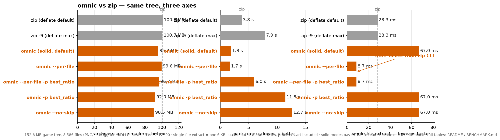
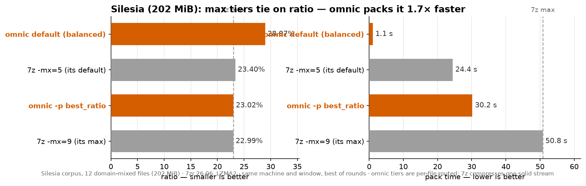

# omnic benchmark

All numbers are measured, same machine (i7-12700, Windows, NVMe SSD),
best-of-rounds, and identical to the tables in the [README](README.md) — this
page is the one-glance version, with the methodology at the bottom.



**The same 152.6 MB game tree (8,586 files — PNG textures, Lua scripts, Ogg
audio, models, fonts, DLLs), every zip tier:**

| option | ratio | archive size | vs zip | pack | single-file extract |
|---|---|---|---|---|---|
| zip (deflate default) | 69.22% | 100.8 MB | — | 3.8 s | 28.3 ms |
| zip -9 (deflate max) | 69.15% | 100.7 MB | -0.1% | 7.9 s | 28.3 ms |
| **omnic pack** (solid, default) | **65.77%** | **95.7 MB** | **-5.0%** | **1.9 s** | 67 ms |
| omnic pack --per-file | 68.4% | 99.6 MB | -1.2% | **1.7 s** | **8.7 ms** |
| omnic pack --per-file -p best_ratio | 66.4% | 96.7 MB | -4.0% | 6.0 s | 8.7 ms |
| omnic pack -p best_ratio | 63.2% | 92.0 MB | -8.7% | **11.5 s** | 67 ms |
| omnic pack --no-skip | **62.2%** | **90.5 MB** | **-10.2%** | 12.7 s | 67 ms |

- **Smaller and faster at the default tier**: -5.0% size at half the pack time.
- **Single-file extraction is the per-file tier's game**: 8.7 ms (process start
  included) vs 28.3 ms for the zip CLI — 3.3×.
- **The ratio ceiling**: --no-skip at -10.2% vs zip, where deflate simply
  cannot follow (it caps at 69.2% at every tier).

## vs 7-Zip — the max tier



Silesia (the standard 202 MiB, 12-domain corpus — novels, dictionary,
chemistry database, C source, medical/X-ray images, binaries, XML; no file
extensions, so every decision goes through content sampling):

| option | ratio | pack |
|---|---|---|
| **omnic default (balanced)** | 28.97% | **1.06 s** |
| 7z -mx=5 (its default) | 23.40% | 24.45 s |
| **omnic -p best_ratio** | 23.02% | **30.2 s** |
| 7z -mx=9 (its max) | **22.99%** | 50.8 s |

Default tiers are different animals (omnic's is a speed tier, 23× faster and
5.6 pp larger). At the max tier they tie on ratio to 0.03 pp — and omnic is
the faster one by 1.7×: block compression runs through a worker pool while a
single 7z stream serializes LZMA2.

Cross-corpus vs zip on Silesia: balanced is 3.2 pp smaller *and* 4.7× faster
to pack (28.97% / 1.06 s vs 32.18% / 4.96 s).

## What's measured, and what it costs

Recorded losses, same protocol: full unpack of the game tree is 3.9 s vs 2.6 s
for signed tar.exe on the same zip content (Windows Defender taxes every file
an unsigned process creates — a bare robocopy of the same tree costs 3.7 s;
block decode+verify without writes is 0.42 s vs 0.36 s, the price of the
per-block CRC that buys corruption isolation). On the big-file Silesia corpus
full unpack is 0.83 s vs zip's 0.37 s. Details and the honest-losses notes
live in the [README's measured section](README.md#archiving-the-same-tree-versus-every-zip-tier).

Corruption isolation, for the record: every block carries a CRC-32; one
flipped bit kills one block and names the affected files while the rest of the
tree extracts cleanly (`extracted 7435/8586 files`, exit code 2). A zip with a
damaged central directory usually gives you nothing.

## Methodology

- **Corpora**: a real game tree (Luanti 5.16 + minetest_game + VoxeLibre,
  152.6 MB, 8,586 files) and the standard Silesia corpus (202 MiB, 12 files).
- **Timing**: wall clock of the whole CLI invocation, best of 3 (pack) or
  best of 5 (millisecond-scale extraction), on an idle machine; zip/7z rows
  measured in the same window as their omnic counterparts.
- **Protocols**: archive rows are directory-to-archive; the whole-stream
  table (README) follows the lzbench / Oodle published protocol. Nothing is
  extrapolated — if a cell is not measured, it is not printed.
- **Reproduce**: corpora described above, `omnic pack <dir> -o out.omnic`
  vs `tar -a -c -f out.zip <dir>` (bsdtar deflate) and `7zr a -mx=9 out.7z`.

## Install

```
scoop bucket add omnic https://github.com/push-rock/omnic-bucket
scoop install omnic
```

or grab a binary from [Releases](https://github.com/push-rock/omnic/releases)
(Windows / Linux / macOS), or build from source — it's CMake + C11.
