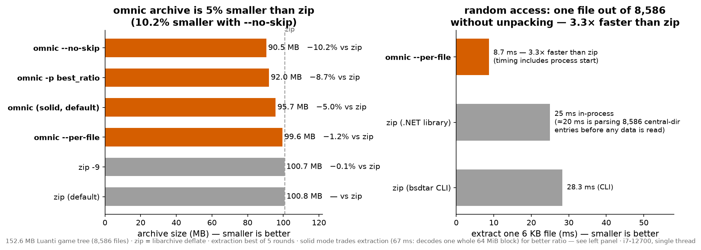
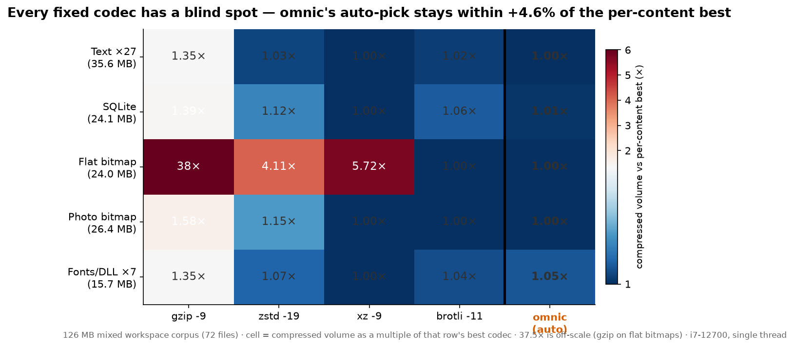
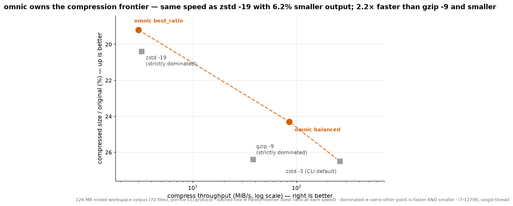
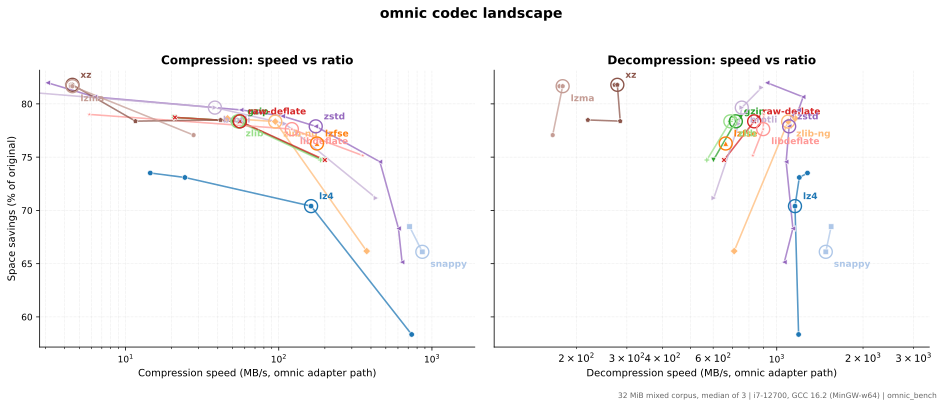

# omnic

**Universal compressor**: recognizes and decompresses 14 mainstream formats with 16 built-in codecs; picks the right algorithm for every file automatically; packs a whole directory tree into one archive that beats zip at every ratio tier.

[English](README.md) | [简体中文](README.zh-CN.md)

[](https://github.com/push-rock/omnic/actions/workflows/ci.yml)

```
$ omnic c report.json
report.json: zstd | balanced | text/code | level 9
    527565 -> 45995 bytes (8.72%), 0.007s, 75.0 MB/s

$ omnic c report.json -p best_ratio
report.json: xz | best_ratio | text/code | level 9
    527565 -> 32108 bytes (6.09%), 0.110s, 4.8 MB/s

$ omnic pack gamedir/
gamedir/: 152644069 -> 100395194 bytes (65.77%), 4.99s
```

## Get it

Prebuilt binaries — **Linux, macOS, Windows**, no installer, no runtime dependencies — are attached to every [GitHub Release](https://github.com/push-rock/omnic/releases). The executable is `bin/omnic` inside the archive (`bin\omnic.exe` on Windows); drop it anywhere on your `PATH`.

The binaries are not code-signed (open-source budget):

- **Windows** — running from cmd/PowerShell is unaffected by SmartScreen; if you launch by double-clicking and get the blue warning, pick *More info → Run anyway*.
- **macOS** — extracting from a terminal (`tar -xzf`) leaves no quarantine flag, the binary runs as-is; if you extract by double-clicking (Archive Utility), clear the flag once: `xattr -d com.apple.quarantine bin/omnic`.

Binaries are built and fully tested by CI on the tagged commit. To build from source instead, see [Build](#build).

## Why omnic

**1. Every format, out of the box.** 16 built-in codecs recognize 14 formats on decompress: gzip (multi-member), zlib, raw deflate, zstd, xz, lzma, lzip, bzip2, lz4, brotli, snappy, compress (.Z), lzfse, lzvn — and 12 of the codecs also compress (three interchangeable implementations for the gzip family alone). Someone hands you an Apple `.lzfse`, a 1989 `.Z`, a bare deflate blob, or a legacy Windows lzma-alone installer — omnic opens it. Magic number first, extension fallback.

**2. Per-file optimal algorithm selection.** The optimal algorithm varies by content — text and databases want xz, flat graphics want brotli (a 4× gap), already-compressed assets want storing — and omnic decides in ~1 ms (three-segment sampling + 8 features + content classification). Measured on a 126 MB real mixed corpus (72 files):

- Its automatic picks land **within +1.4% of the theoretical per-file optimum**; fixed `zstd -19` pays +7.7%, fixed `brotli -11` +3.2%;
- 4 of 6 content groups hit the exact optimum; the worst group is only +4.6% off;
- `best_ratio` produces **6.2% smaller** output than `zstd -19` at the same compress speed; `balanced` beats `gzip -9` on all three axes: **8.6% smaller, 2.2× faster compression, 2.1× faster decompression**;
- Already-compressed assets (PNG/Ogg) pass through byte-exact — zero wasted CPU.

**3. Archiving beats zip.** The same real game tree, 152.6 MB (8,586 files):

- The archive is **5.0% smaller than zip** (95.7 vs 100.8 MB); the `--no-skip` tier is **10.2% smaller** (90.5 MB) — deflate caps at 69.2% at every tier, and omnic's default tier reaches **65.8%**;
- Packing is **1.6× faster than zip -9** (28.8 vs 18.4 MB/s), same tier as default zip (28.8 vs 38.1);
- Single-file extraction: **8.7 ms — 3.3× faster than zip** (zip CLI 28.3 ms, .NET library 25 ms); full unpack now writes through a parallel worker pool (8 by default, `-T` to tune): 4.3 s → 3.9 s here under Windows Defender — the residual gap to zip (2.6 s) is the antivirus scanning each new file from an unsigned process; exclude the output directory or run AV-free for the full speedup;
- Capabilities zip lacks: corruption isolation (one flipped bit kills one block — `extracted 7435/8586`, the rest still come out), `--verify` no-write full verification (260 MB/s), `--list` without touching the data region (96 ms);
- `--per-file` (per-entry random access) and solid (whole-stream max ratio, xz-class 63.2%) are one flag apart;
- Cross-corpus confirmation on the standard Silesia benchmark (202 MiB, 12 mixed domains, no file extensions): **balanced beats zip-deflate on both axes — 10% smaller archive, 2.1× faster packing**; `best_ratio` lands 9.2 pp below zip.

## Supported codecs

| codec | format | levels | notes |
|---|---|---|---|
| zstd 1.5.7 | .zst | -5..22 | multithreaded |
| lz4 1.10.0 | .lz4 | 0..12 | level 0 = fast mode, 1..12 = LZ4HC |
| xz 5.8.4 | .xz | 0..9 | CRC64 |
| zlib 1.3.2 | .gz | 0..9 | streaming, multi-member gzip on decompress |
| zlib-ng 2.3.3 | .gz | 0..9 | same format, faster implementation |
| libdeflate 1.26 | .gz | 0..12 | whole-buffer API, highest gzip speed |
| brotli 1.2.1 | .br | 0..11 | |
| snappy 1.3.1 | .snappy | 1..2 | official framing format (magic + CRC32C + 64 KB chunks) |
| lzfse 1.0 | .lzfse | — | single speed point |
| zlib-stream | .zlib | 0..9 | RFC 1950 wrapper, same zlib library |
| raw-deflate | .zz | 0..9 | headerless deflate, recognized by extension; no checksum — corrupted streams can decode silently (format-inherent) |
| lzma | .lzma | 0..9 | lzma-alone container, via liblzma |
| lzvn | .lzvn | decode only | "bvn" streams, shares the lzfse block decoder |
| lzip | .lz | decode only | lzip container (v0/v1), via liblzma, multi-member |
| bzip2 1.0.8 | .bz2 | decode only | vendored decode half, concatenated streams |
| compress | .Z | decode only | LZW (ncompress semantics), self-contained decoder |

All adapters share one interface (`src/codec/ac_*.c`), so adding a codec is a single file plus a registry entry.

## Usage

```
omnic c   [options] <file...>    compress (auto codec unless -c)
omnic d   [options] <file...>    decompress (auto format by magic/ext; .omnic → whole tree)
omnic pack   [options] <dir>     pack a directory tree into one .omnic archive
omnic unpack [options] <arc>     extract / list / verify a .omnic archive
omnic analyze <file...>          show type/entropy/decision, no side effects
omnic list                       list codecs and recognized formats

-p --profile <v>   fast_compress | fast_decompress | best_ratio | balanced
-c --codec <name>  force a codec            -l --level <n>  codec-native level
-T --threads <n>   workers (zstd pack; unpack writes)    -o --output-dir <dir>
-f --force    overwrite output / compress anyway / --file target exists
-k --keep     keep the source file (default: removed after success)
-x --explain  print the decision rationale  -q --quiet

pack:   --per-file  one block per file (ms single-file extract, worse ratio)
        --no-skip   compress already-compressed assets too (store by default)
        --block-size <MiB>  solid block limit, 1..1024 (default 64)
unpack: --file <path>  extract only this entry (repeatable)
        --list         name/size/codec/ratio without touching the data area
        --verify       check both CRC layers, write nothing
        -C --dir <dir> output root
```

## Measured results

All numbers measured on one machine (i7-12700, single thread, best of rounds); reproduction tools ship with the build: `omnic_bench` (codec level), `omnic_gamepack` (archive level).

**The headline numbers** — one figure per line, sources in the tables below:

1. **Packing the same 152.6 MB game tree: the archive is 5.0% smaller than zip** (95.7 vs 100.8 MB); the `--no-skip` tier reaches **90.5 MB, 10.2% smaller**. deflate caps at 69.2% at every tier; omnic's default tier is 65.8%.
2. **Extracting one file out of 8,586 entries: 3.3× faster** — omnic 8.7 ms, zip CLI 28.3 ms, .NET library 25 ms.
3. **Per-file algorithm selection lands within +1.4% of the theoretical optimum** (72-file hindsight control); fixed `zstd -19` is +7.7%, fixed `brotli -11` +3.2%.
4. **At equal compress speed, 6.2% smaller than `zstd -19`**; versus `gzip -9` a clean sweep: **8.6% smaller, 2.2× faster compression, 2.1× faster decompression**.
5. **A 24 MB flat bitmap compresses to 744 bytes (1/33,000)** — brotli's specialty; zstd -19 / xz -9 only reach 3.0 / 4.3 KB. omnic picks brotli.
6. **Every fixed algorithm has a disaster row**: gzip -9 is at least 1/3 larger on all five compressible groups (photo row +58%); zstd -19 is 4.1× larger on flat bitmaps, xz -9 5.7×; brotli -11 has no disaster row but runs at 1.0 MB/s throughout. omnic's worst group is +4.6%.
7. **Stream mode decompresses at 1060 MiB/s** — 1.8× Oodle Kraken-5's published estimate — with ratio up to xz-class 57.0%.
8. **Cross-corpus check — standard Silesia (202 MiB, 12 domains): balanced beats zip-deflate on both axes**: 29.0% vs 32.2% ratio, 2.4 vs 5.0 s pack; `best_ratio` reaches 23.0% (9.2 pp below zip).



### Single files: the optimal codec varies by content — omnic picks right every time

**No single algorithm is optimal on all content.** A 126 MB real mixed corpus (72 files), grouped by content and compressed with four max-level codecs — the winner differs per row; omnic's automatic picks (~1 ms per file) hit or trail each row's best:

| content | gzip -9 | zstd -19 | xz -9 | brotli -11 | omnic auto-pick |
|---|---|---|---|---|---|
| text ×27, 35.6 MB | 36.9% | 28.1% | **27.3%** | 27.9% | xz 9 → **27.3%**, exact hit |
| SQLite database, 24.1 MB | 28.6% | 22.9% | **20.5%** | 21.8% | xz 6 → 20.6%, +0.6% off best |
| synthetic flat bitmap, 24.0 MB | 27.9 KB | 3.05 KB | 4.26 KB | **744 B** | brotli 11 → **744 B**, exact hit (runner-up is 4.1× larger) |
| photo bitmap, 26.4 MB | 21.8% | 15.8% | **13.8%** | 13.8% | xz 6 → 13.8%, exact hit |
| fonts/DLLs ×7, 15.7 MB | 47.3% | 37.6% | **35.1%** | 36.5% | per-file mix → 36.7%, +4.6% off best (worst group, still beats fixed zstd -19) |
| already-compressed PNG/Ogg ×35, 0.09 MB | 95.9% | 94.9% | 96.7% | 94.6% | **pass-through** (zero compression CPU; fixed codecs grind for ~5% in-group) |



- **Every fixed codec has a disaster row**: gzip -9 is at least 1/3 larger on all five compressible groups (photo row +58%); zstd -19 is 4.1× larger on flat bitmaps; xz -9 5.7×; brotli -11 has no disaster row but wins none either (except flat bitmaps), running at 1.0 MB/s throughout (measured on Silesia).
- **omnic hits the exact optimum in 4 of 6 groups** — +0.6% on the database, +4.6% in the worst group. Storing already-compressed assets is a time decision: the group is only 0.09 MB in this corpus but 82 MB in the next section's tree, and a fixed codec grinds all of it.
- Tree-wide hindsight control: compress each of the 72 files with all four options, take each file's minimum (the theoretical optimum) — omnic's automatic picks are **only 1.4% larger**; fixed zstd -19 is 7.7% larger, fixed brotli -11 3.2%; this corpus is text-heavy, so fixed xz -9 happens to sit near the optimum (+0.2%) — which is exactly the point of routing: you don't need to know what your data is.

**Speed position** — each profile has one clean win (same tree, per-file CLI protocol):

| matchup | size | compress | decompress | verdict |
|---|---|---|---|---|
| **balanced** vs `gzip -9` | **8.6% smaller** | **2.2× faster** | **2.1× faster** | **wins all three axes** |
| **best_ratio** vs `zstd -19` | **6.2% smaller** | 3.0 vs 3.2 MiB/s, tied | 188 vs 623 MiB/s, xz decode cost | same compress speed, **6.2% smaller** |
| **balanced** vs `zstd -3` (CLI default) | **9.1% smaller** | 85 vs 261 MiB/s, opponent 3.1× faster | 736 vs 658 MiB/s | 9.1% smaller, at 3× the pack time |



- How it decides: extension routing + 8 features refined into 7 content classes, table lookup yields `(codec, level)`; for large files the `fast_compress` profile trial-compresses its top-2 candidates within a 50 ms budget; `--explain` prints the whole chain. The decision table is fitted from a 22-distribution × 44-config benchmark matrix and ships only after passing a leave-one-out regret bound (ρ ≤ 1.0 pp).
- Codec-level landscape (Silesia, 212 MiB standard corpus, measured with `omnic_bench`):



Adapter overhead: ≤0.8% on compression / ≤1.4% on decompression, and several decompression paths are actually faster than direct library calls (fixed-size chunk buffers stay cache-hot).

### Archiving: the same tree versus every zip tier

A 152.6 MB real game tree (Luanti 5.16 + minetest_game + VoxeLibre; 8,586 files — PNG textures, Lua scripts, Ogg audio, models, fonts, DLLs):

| option | ratio | archive size | vs zip | pack | single-file extract |
|---|---|---|---|---|---|
| zip (deflate default) | 69.22% | 100.8 MB | — | **3.8 s** | 28.3 ms |
| zip -9 (deflate max) | 69.15% | 100.7 MB | -0.1% | 7.9 s | 28.3 ms |
| **omnic pack** (solid, default) | **65.77%** | **95.7 MB** | **-5.0%** | 5.0 s | 67 ms |
| omnic pack --per-file | 68.4% | 99.6 MB | -1.2% | 8.4 s | **8.7 ms** |
| omnic pack --no-skip | **62.2%** | **90.5 MB** | **-10.2%** | 18.9 s | 67 ms |
| omnic pack -p best_ratio | 63.2% | 92.0 MB | -8.7% | 23.9 s | 67 ms |

- deflate caps at 69.2% no matter the tier (-9 spends 2.1× the time for 0.07 pp); omnic's default tier reaches 65.8% — **5.0% smaller** — and packs 1.6× faster than zip -9 (throughput 28.8 vs 18.4 MB/s).
- Single-file extraction: pulling one 6 KB Lua file from 8,586 entries — omnic `--per-file` 8.7 ms (process start included), zip CLI 28.3 ms, .NET library (ZipFile + stream copy) 25 ms — **3.3× faster**; solid mode 67 ms (the cost of reading and decoding one whole 64 MiB block).
- Unpack wall clock: 4.3 s serial → **3.9 s** with the default 8 write workers (3.6 s at `-T 2`) vs 2.6 s for signed tar.exe on the same zip. Breakdown: no-write decode+verify 0.56 s vs 0.36 s (deflate decode is inherently fast, and omnic adds a per-block CRC — the price of corruption isolation); the rest is file creation, and on this machine most of that is Windows Defender real-time scanning every file an unsigned process creates (a plain robocopy of the same tree costs 3.7 s; signed tar.exe pays none of the AV tax). Exclude the output directory from Defender — or run on Linux/macOS — and the parallel writers deliver their full speedup.
- Corruption isolation: every block carries a CRC-32; one flipped bit kills one block, extraction reports each affected file then continues (`extracted 7435/8586 files`, exit code 2). A zip with a damaged central directory usually gives you nothing. `--list` reads only the tail index: 8,586 entries in 96 ms.

**Cross-corpus check: the standard Silesia benchmark** (12 domain-mixed files — novels, dictionary, chemistry database, C source, medical/X-ray images, binaries, XML; 202 MiB; no file extensions, so the decider routes everything through content sampling):

| option | ratio | archive size | vs zip | pack |
|---|---|---|---|---|
| zip (deflate default) | 32.18% | 65.0 MB | — | 4.96 s |
| omnic `-p fast_compress` | 41.02% | 82.9 MB | +27.5% | **1.08 s** |
| omnic `-p fast_decompress` | 31.37% | 63.4 MB | -2.5% | 1.36 s |
| **omnic pack (default)** | **28.97%** | **58.6 MB** | **-10.0%** | **2.41 s** |
| omnic `-p best_ratio` | **23.02%** | **46.5 MB** | **-28.5%** | 87.4 s |

- balanced wins both axes: **3.2 pp smaller ratio and 2.1× the pack speed**; `fast_decompress` matches zip's ratio at 3.6× the speed; `best_ratio` sits 9.2 pp below zip — the archival tier.
- Losses recorded: full unpack of this big-file corpus is 0.83 s vs zip's 0.37 s (solid zstd decode plus the per-block CRC isolation tax; the parallel-write path targets many-file trees like the one above). `--file` extraction of the 10 MB member takes 48 ms — decode-bound; the 8.7 ms headline is a 6 KB file.

**Whole-stream max compression** (tar the tree, then one stream — the lzbench / Oodle published protocol):

| configuration | ratio | compress | decompress |
|---|---|---|---|
| xz -9 (library ratio ceiling) | 56.8% | 3.5 MiB/s | 81 MiB/s |
| **omnic `best_ratio`** → xz 6 | **57.0%** | 3.9 | 79 |
| Oodle Kraken-5* | ~57.8% | — | ~590 |
| zstd -19 (local Kraken-5 proxy) | 57.9% | 5.4 | 579 |
| **omnic `balanced`** → zstd 9 | 59.5% | 84 | **652 / 1060†** |
| lz4 -12 (speed anchor) | 66.0% | 23 | 718 |

`balanced` stream decompression runs at **1060 MiB/s — 1.8× the Kraken-5 estimate** — paying 1.7 pp of ratio for it; `best_ratio` beats the Kraken-5 ratio estimate by 0.8 pp. No single configuration beats Kraken on both axes at once — the profile system is how you pick a side.

\* Kraken has no public binary; its figures are third-party same-machine measurements converted with a machine coefficient (±8% sensitivity). zstd-19 independently reproduces the Kraken-5 anchor on Silesia, which is why it serves as the proxy row above.
† Two decompression protocols on the same bytes — the compressed output is byte-identical, and both go through the same library call: 652 MiB/s holds the whole stream in RAM and decodes in one shot (the lzbench-style protocol every other row in this table uses, the Kraken-5 estimate included); 1060 MiB/s is omnic's actual streaming pipeline, which reuses fixed 4 MiB buffers end-to-end so the working set stays cache-resident. The buffering strategy is the entire difference.

## Build

Requires CMake ≥ 3.16 and a C11 compiler (MSVC / GCC / Clang). All codecs are vendored — no system dependencies.

```bash
cmake -B build -DCMAKE_BUILD_TYPE=Release
cmake --build build -j
./build/omnic list
ctest --test-dir build
```

## License

MIT. Vendored codecs keep their own licenses, see `THIRD_PARTY_NOTICES.md`. No GPL/LGPL code is linked by default (`OMNIC_ENABLE_GPL` is reserved for optional builds).
