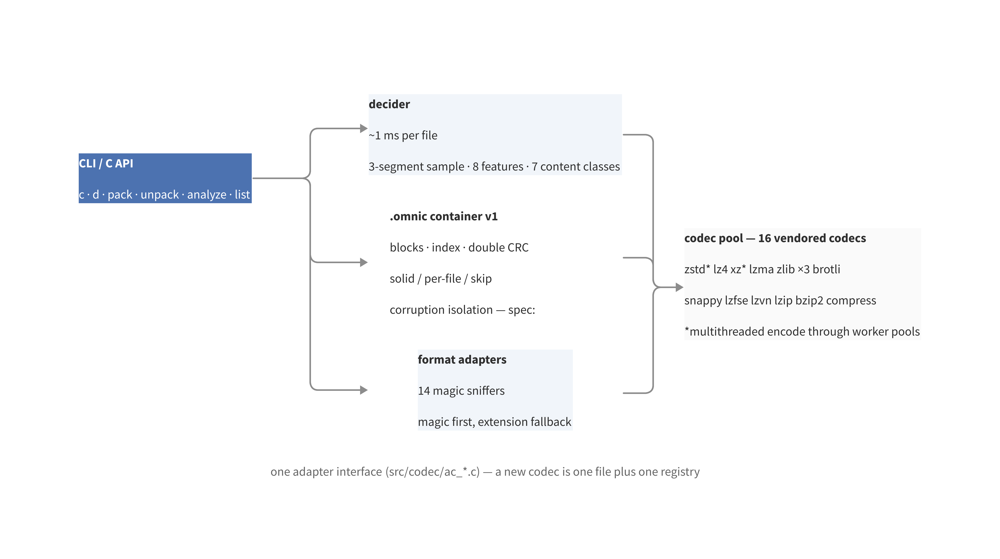
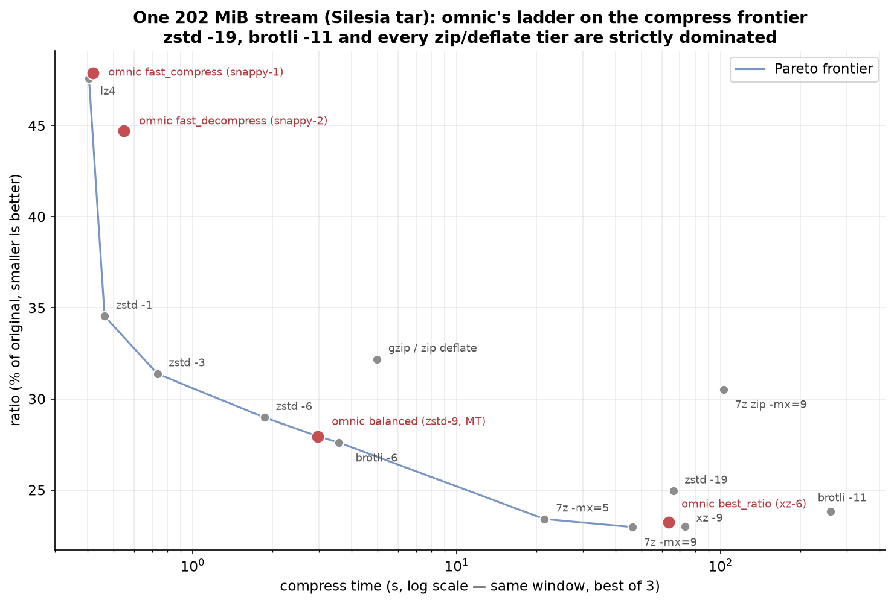
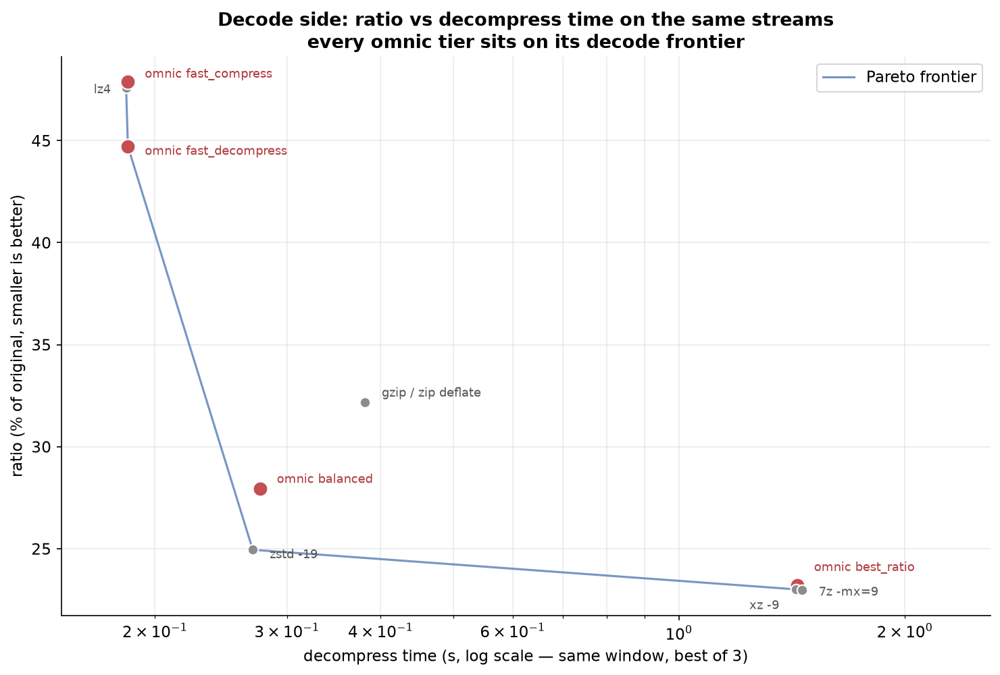
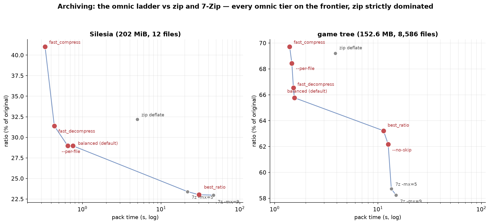

# omnic

**One container for every codec.** omnic is a universal compressor: it reads
14 mainstream formats, picks the right algorithm for every file in ~1 ms,
and packs whole directory trees into archives whose default tier beats zip on
both axes — 10% smaller at 6.6× the pack speed — and whose top tier ties
7-Zip's max ratio at 1.5× its speed.

[English](README.md) | [简体中文](README.zh-CN.md)

[](https://github.com/push-rock/omnic/actions/workflows/ci.yml)

```
$ omnic c report.json
report.json: zstd | balanced | text/code | level 9
    527565 -> 45995 bytes (8.72%), 0.007s, 75.0 MB/s

$ omnic c report.json -p best_ratio
report.json: xz | best_ratio | text/code | level 9
    527565 -> 32108 bytes (6.09%), 0.110s, 4.8 MB/s

$ omnic pack gamedir/
gamedir/: 152644069 -> 100395194 bytes (65.77%), 1.55s

$ omnic unpack backup.omnic --verify
verified 12/12 files, 4 blocks OK
```

## Get it

**Windows (scoop)**:

```
scoop bucket add omnic https://github.com/push-rock/omnic-bucket
scoop install omnic
```

**winget**: `winget install push-rock.omnic` (package submission in review — until it lands, use scoop or the binaries below).

Prebuilt binaries — **Linux, macOS, Windows**, no installer, no runtime dependencies — are attached to every [GitHub Release](https://github.com/push-rock/omnic/releases). The executable is `bin/omnic` inside the archive (`bin\omnic.exe` on Windows); drop it anywhere on your `PATH`. For the numbers behind the pitch on one page, see [BENCHMARK.md](BENCHMARK.md).

The binaries are not code-signed (open-source budget):

- **Windows** — running from cmd/PowerShell is unaffected by SmartScreen; if you launch by double-clicking and get the blue warning, pick *More info → Run anyway*.
- **macOS** — extracting from a terminal (`tar -xzf`) leaves no quarantine flag, the binary runs as-is; if you extract by double-clicking (Archive Utility), clear the flag once: `xattr -d com.apple.quarantine bin/omnic`.

Binaries are built and fully tested by CI on the tagged commit. To build from source instead, see [Build](#build).

## Why omnic

**The goal is one container for the whole zoo.** Every archive format in
common use welds itself to one algorithm — and inherits that algorithm's
ceiling, its blind spots, and its obsolescence schedule. omnic bets on the
opposite shape: a **thin, frozen container** whose only jobs are block
layout, the entry index, and two CRC layers (the complete byte-level
definition is [FORMAT.md](FORMAT.md)), while **every codec ever shipped
stays a replaceable part inside it**.

Four properties follow — each a design decision, not a bonus:

- **Every format, both directions.** 16 built-in codecs recognize 14
  mainstream formats on decompress: gzip, zstd, xz, brotli, lzip, bzip2,
  Apple lzfse/lzvn, 1989 compress(.Z) — magic number first, extension
  fallback. Whatever the world hands you, omnic opens it; whatever omnic
  writes in single-file mode is a plain standard stream any tool can read.
  Backward compatibility is the floor the new container stands on.
- **Forward exploration without lock-in.** The container records which codec
  produced each block, so an archive written today already accepts codecs
  that don't exist yet — and when a codec gets faster next year, every
  archive you already own gains the improvement on decode. The codec race
  becomes your dividend instead of your migration cost.
- **The decision is the product.** The optimal algorithm varies by content —
  by up to 4× between the right and wrong codec on the same file. omnic
  decides per file in ~1 ms (three-segment sampling + 8 features + 7 content
  classes; the decision table ships only after passing a leave-one-out
  regret bound). You should not have to know what your data is.
- **Measured Pareto, not claimed.** The four profiles form a speed/ratio
  ladder. On both benchmark corpora the ladder brackets the Pareto
  frontier of the mainstream compressors tested — and the famous fixed
  settings (zstd -19, brotli -11, every zip/deflate tier) are strictly
  dominated. Charts, raw numbers and the remaining losses are all in
  [Measured results](#measured-results).

Corruption isolation — one flipped bit kills one block, the affected files
are named, the rest still extract — falls out of the container design and
is covered there.

## Architecture

The pack path is a pipeline: identify each file, pick its codec, compress, and pack into a CRC-verified container.



- **pack**: a classify pool (8 workers) walks the tree, buckets files by
  compression affinity, blocks are built on the main thread, compressed by
  a second worker pool, written in dispatch order — parallel and serial
  output byte-identical.
- **unpack**: a decode pool decompresses blocks ahead of the main loop,
  entries are reaped in order, CRC-checked, and handed to a write pool
  (engages at ≥32 entries or ≥8 MiB). CRC-32 itself runs slice-by-8.
- omnic's own numbers are reproducible: `omnic_bench` (codec level) and
  `omnic_gamepack` (archive level) ship with the build.

## Supported codecs

| codec | format | levels | notes |
|---|---|---|---|
| zstd 1.5.7 | .zst | -5..22 | multithreaded |
| lz4 1.10.0 | .lz4 | 0..12 | level 0 = fast mode, 1..12 = LZ4HC |
| xz 5.8.4 | .xz | 0..9 | CRC64; multithreaded with -T |
| zlib 1.3.2 | .gz | 0..9 | streaming, multi-member gzip on decompress |
| zlib-ng 2.3.3 | .gz | 0..9 | same format, faster implementation |
| libdeflate 1.26 | .gz | 0..12 | whole-buffer API, highest gzip speed |
| brotli 1.2.1 | .br | 0..11 | |
| snappy 1.3.1 | .snappy | 1..2 | official framing format (magic + CRC32C + 64 KB chunks) |
| lzfse 1.0 | .lzfse | — | single speed point |
| zlib-stream | .zlib | 0..9 | RFC 1950 wrapper, same zlib library |
| raw-deflate | .zz | 0..9 | headerless deflate, recognized by extension; no checksum — corrupted streams can decode silently (format-inherent) |
| lzma | .lzma | 0..9 | lzma-alone container, via liblzma |
| lzvn | .lzvn | decode only | "bvn" streams, shares the lzfse block decoder |
| lzip | .lz | decode only | lzip container (v0/v1), via liblzma, multi-member |
| bzip2 1.0.8 | .bz2 | decode only | vendored decode half, concatenated streams |
| compress | .Z | decode only | LZW (ncompress semantics), self-contained decoder |

All adapters share one interface (`src/codec/ac_*.c`), so adding a codec is a single file plus a registry entry.

## Usage

```
omnic c   [options] <file...>    compress (auto codec unless -c)
omnic d   [options] <file...>    decompress (auto format by magic/ext; .omnic → whole tree)
omnic pack   [options] <dir>     pack a directory tree into one .omnic archive
omnic unpack [options] <arc>     extract / list / verify a .omnic archive
omnic analyze <file...>          show type/entropy/decision, no side effects
omnic list                       list codecs and recognized formats

-p --profile <v>   fast_compress | fast_decompress | best_ratio | balanced
-c --codec <name>  force a codec            -l --level <n>  codec-native level
-T --threads <n>   workers (classify; zstd/xz compress; unpack writes)  -o --output-dir <dir>
-f --force    overwrite output / compress anyway / --file target exists
-k --keep     keep the source file (default: removed after success)
-x --explain  print the decision rationale  -q --quiet

pack:   --per-file  one block per file (ms single-file extract, worse ratio)
        --no-skip   compress already-compressed assets too (store by default)
        --block-size <MiB>  solid block limit, 1..1024 (default 64)
unpack: --file <pattern>  extract matching entries (exact path, dir/ prefix, or * glob; repeatable)
        --list         name/size/codec/ratio without touching the data area
        --verify       check both CRC layers, write nothing
        -C --dir <dir> output root
```

## Measured results

One machine (i7-12700), one window, every competitor measured together
with omnic in the same session — 7-Zip 26.06, the system tar (bsdtar,
zip/gzip), and codec-native levels through omnic's own vendored libraries
(`-c <codec> -l <level>`). Best of 3 (best of 7 for millisecond-scale
extraction). `omnic_bench` and `omnic_gamepack` reproduce omnic's rows;
the competitor rows are the stock commands shown in each table.

### One stream, every compressor: the Pareto picture

The 202 MiB Silesia corpus as a plain tar, compressed by everything we
could run. X axis is compress time (log scale), Y axis is ratio — the
lower-left corner wins:



- **The ladder brackets the frontier**: `fast_compress` ties lz4 at the
  speed end, `balanced` (zstd-9, multithreaded) owns the middle,
  `best_ratio` (xz-6) holds the ratio end against 7-Zip's LZMA2.
- **Famous fixed settings are strictly dominated**: zstd -19 (slower *and*
  larger than omnic's xz-6 pick), brotli -11 (260 s — 4× slower than
  best_ratio for a worse ratio), every zip/deflate tier (slower and larger
  than balanced).
- `fast_decompress` optimizes the other axis — see below.

Decode side, same streams:



The ladder holds on the decode side too — snappy-class decode (1.1 GB/s)
for the fast profiles (tying lz4), zstd-class for balanced, xz-class at the
ratio end.

Raw numbers behind both charts (202 MiB Silesia tar):

| configuration | compress | ratio | decompress |
|---|---|---|---|
| lz4 | **0.40 s** | 47.60% | **0.18 s** |
| **omnic fast_compress** (snappy-1) | 0.42 s | 47.88% | 0.18 s |
| zstd -1 | 0.46 s | 34.54% | 0.27 s |
| **omnic fast_decompress** (snappy-2) | 0.55 s | 44.72% | 0.18 s |
| zstd -3 | 0.73 s | 31.38% | 0.27 s |
| zstd -6 | 1.87 s | 28.98% | 0.27 s |
| **omnic balanced** (zstd-9, MT) | 2.98 s | 27.95% | 0.28 s |
| brotli -6 | 3.58 s | 27.60% | — |
| gzip / zip deflate (bsdtar) | 4.97 s | 32.18% | 0.38 s |
| 7z -mx=5 (its default) | 21.5 s | 23.41% | — |
| 7z -mx=9 (its max) | 46.2 s | **22.97%** | 1.46 s |
| **omnic best_ratio** (xz-6) | 63.6 s | 23.22% | 1.44 s |
| xz -9 | 73.1 s | 23.00% | 1.43 s |
| zstd -19 | 66.1 s | 24.95% | 0.27 s |
| brotli -11 | 260.1 s | 23.83% | — |
| 7z zip format, -mx=9 | 102.4 s | 30.53% | — |

### Per-type picks: the decider earns its keep

Same window, per file: omnic's automatic picks vs every zip tier and
7-Zip's max. `balanced` (zstd) beats **both** zip tiers on **every** file:

| file | kind | omnic balanced | omnic best_ratio | zip deflate | zip -9 (7z) | 7z -mx=9 |
|---|---|---|---|---|---|---|
| dickens | novel text | zstd 33.54% | xz 27.96% | 37.99% | 36.12% | **27.78%** |
| mozilla | executables | zstd 33.79% | xz 29.45% | 37.25% | 35.58% | **26.05%** |
| mr | recorded data | zstd 33.95% | xz 31.16% | 36.87% | 34.63% | **27.56%** |
| nci | chemical DB | zstd 7.23% | xz **4.96%** | 9.54% | 8.23% | 5.19% |
| ooffice | office binary | zstd 47.79% | xz 42.21% | 50.33% | 48.68% | **39.43%** |
| osdb | SQL DB | zstd 33.67% | xz 30.74% | 36.62% | 35.87% | **28.28%** |
| reymont | novel text | zstd 26.74% | xz 20.33% | 28.07% | 25.62% | **19.89%** |
| samba | source code | zstd 21.20% | xz 18.03% | 25.22% | 23.70% | **17.40%** |
| sao | star coords | zstd 72.70% | xz 68.95% | 73.53% | 72.24% | **60.87%** |
| webster | dictionary | zstd 26.07% | xz 20.94% | 29.45% | 27.87% | **20.23%** |
| x-ray | medical img | zstd 65.51% | xz 60.53% | 71.34% | 67.81% | **52.86%** |
| xml | XML | zstd 10.23% | xz **8.47%** | 12.87% | 11.85% | 8.51% |

- The single-file `best_ratio` pick (xz-6) trails 7-Zip's full LZMA2 on
  most files — honestly recorded. The ratio race belongs to the **archive**
  tier, where solid clustering and dual-candidate trials bring omnic level
  with 7z -mx=9 (23.02% vs 22.97% below).
- How it decides: content magic bytes outrank the extension (a renamed PNG
  still passes through; text renamed to .jpg still compresses), then
  extension routing + 8 features refined into 7 content classes, table
  lookup yields `(codec, level)`; for large files the `fast_compress`
  profile trial-compresses its top-2 candidates within a 50 ms budget;
  `--explain` prints the whole chain.

### Archiving: two corpora, every tier



Silesia (202 MiB, 12 domain-mixed files, no extensions — every decision
goes through content sampling):

| option | ratio | archive size | vs zip | pack |
|---|---|---|---|---|
| zip (deflate, bsdtar) | 32.18% | 65.0 MB | — | 4.99 s |
| 7z -mx=5 (its default) | 23.40% | 47.3 MB | -27.3% | 21.6 s |
| **7z -mx=9 (its max)** | **22.97%** | 46.4 MB | **-28.6%** | 46.3 s |
| **omnic fast_compress** | 41.01% | 82.9 MB | +27.5% | **0.34 s** |
| **omnic fast_decompress** | 31.38% | 63.4 MB | -2.5% | 0.44 s |
| **omnic pack (default)** | **28.97%** | **58.6 MB** | **-10.0%** | **0.76 s** |
| **omnic -p best_ratio** | **23.02%** | **46.5 MB** | **-28.5%** | **30.2 s** |

Game tree (152.6 MB, 8,586 real files — Luanti 5.16 + minetest_game +
VoxeLibre: PNG textures, Lua scripts, Ogg audio, models, fonts, DLLs):

| option | ratio | archive size | vs zip | pack |
|---|---|---|---|---|
| zip (deflate, bsdtar) | 69.20% | 100.7 MB | — | 3.86 s |
| 7z -mx=5 | 58.73% | 85.5 MB | -15.1% | 13.4 s |
| **7z -mx=9** | **58.24%** | **84.7 MB** | **-15.8%** | 14.9 s |
| **omnic fast_compress** | 69.71% | 101.5 MB | +0.7% | **1.40 s** |
| **omnic fast_decompress** | 66.54% | 96.9 MB | -3.8% | **1.52 s** |
| **omnic pack (default)** | **65.77%** | **95.7 MB** | **-5.0%** | **1.55 s** |
| **omnic --per-file** | 68.43% | 99.6 MB | -1.1% | **1.47 s** |
| **omnic -p best_ratio** | 63.22% | 92.0 MB | -8.6% | **11.3 s** |
| **omnic --no-skip** | **62.17%** | **90.5 MB** | **-10.2%** | 12.5 s |

- Default tiers are different animals: zip's default is its only tier
  (deflate), 7z's default is already a ratio tier. omnic's default is a
  **speed tier that still lands 10% smaller than zip at 6.6× the pack
  speed**; `best_ratio` ties 7z's max within 0.05 pp on Silesia while
  packing 1.5× faster, and `--no-skip` is the ratio sprint (62.2% on the
  game tree).
- Extraction, same window: one 111 KiB member out of 8,586 entries —
  `--per-file` **8.8 ms** vs zip's 26.9 ms (**3×**); solid mode 54 ms
  (decodes the whole 64 MiB block). Full unpack of Silesia: **0.20 s** vs
  zip's 0.38 s. `--verify` walks both CRC layers at ~1 GB/s without
  writing a byte.
- Corruption isolation: every block carries a CRC-32; one flipped bit
  kills one block, extraction names the affected files and continues
  (`extracted 7435/8586 files`, exit code 2). A zip with a damaged central
  directory usually gives you nothing.
- `--list` reads only the tail index: 8,586 entries in 7.5 ms.

### Whole-stream max compression (v0.3.3 window)

The lzbench / Oodle published protocol — tar the tree, then one stream:

| configuration | ratio | compress | decompress |
|---|---|---|---|
| xz -9 (library ratio ceiling) | 56.8% | 3.5 MiB/s | 81 MiB/s |
| **omnic `best_ratio`** → xz 6 | **57.0%** | 3.9 | 79 |
| Oodle Kraken-5* | ~57.8% | — | ~590 |
| zstd -19 (local Kraken-5 proxy) | 57.9% | 5.4 | 579 |
| **omnic `balanced`** → zstd 9 | 59.5% | 84 | **652 / 1060†** |
| lz4 -12 (speed anchor) | 66.0% | 23 | 718 |

`balanced` stream decompression runs at **1060 MiB/s — 1.8× the Kraken-5
estimate** — paying 1.7 pp of ratio for it; `best_ratio` beats the
Kraken-5 ratio estimate by 0.8 pp. No single configuration beats Kraken on
both axes at once — the profile system is how you pick a side.

\* Kraken has no public binary; its figures are third-party same-machine measurements converted with a machine coefficient (±8% sensitivity). zstd-19 independently reproduces the Kraken-5 anchor on Silesia, which is why it serves as the proxy row above.
† Two decompression protocols on the same bytes — the compressed output is byte-identical, and both go through the same library call: 652 MiB/s holds the whole stream in RAM and decodes in one shot (the lzbench-style protocol every other row in this table uses, the Kraken-5 estimate included); 1060 MiB/s is omnic's actual streaming pipeline, which reuses fixed 4 MiB buffers end-to-end so the working set stays cache-resident. The buffering strategy is the entire difference.

### Honest losses

- **Full unpack of the game tree: 3.2 s vs zip's 1.8 s** on Windows. The
  engine part is 0.12 s (decode + double CRC); creating 8,586 files costs
  the rest — and Windows Defender real-time scanning adds ~1.4 s for an
  unsigned process (a bare robocopy of the same tree costs 3.7 s; the
  signed tar doesn't pay this tax). With the output directory excluded
  from Defender, omnic's unpack drops to ~1.8 s — on par with tar. On
  Linux/macOS there is no such tax.
- **`fast_compress` is a speed tier, not a ratio tier** — on Silesia it
  lands 41% vs zip's 32%. It is the right answer when the input is
  mostly already-compressed (the game tree: 1.4 s, ratio within half a
  point of zip's — 69.7% vs 69.2%).
- **Single-file `best_ratio` (xz-6) trails 7z -mx=9 per file** (see the
  per-type table); omnic's ratio parity with 7-Zip happens at the archive
  tier, not the single-file tier.
- **Extracting one large member from a solid archive**: 104 ms for the
  10 MB dickens (decodes a 50 MiB block) vs zip's 28 ms. Use
  `--per-file` when single-member latency matters.
- 7-Zip also wins GUI, encryption, format breadth and 25 years of
  maturity — it stays installed here. omnic bets on per-file routing,
  pass-through, the frozen container spec and corruption isolation, not
  on replacing it.

## Build

Requires CMake ≥ 3.16 and a C11 compiler (MSVC / GCC / Clang). All codecs are vendored — no system dependencies.

```bash
cmake -B build -DCMAKE_BUILD_TYPE=Release
cmake --build build -j
./build/omnic list
ctest --test-dir build
```

## License

MIT. Vendored codecs keep their own licenses, see `THIRD_PARTY_NOTICES.md`. No GPL/LGPL code is linked by default (`OMNIC_ENABLE_GPL` is reserved for optional builds).
