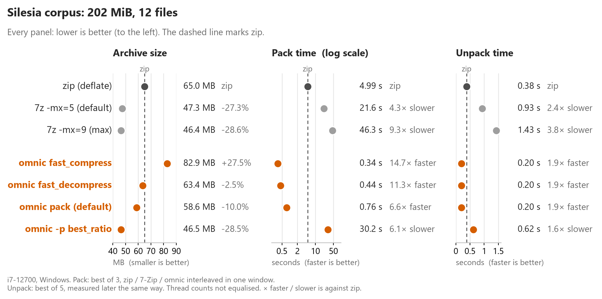
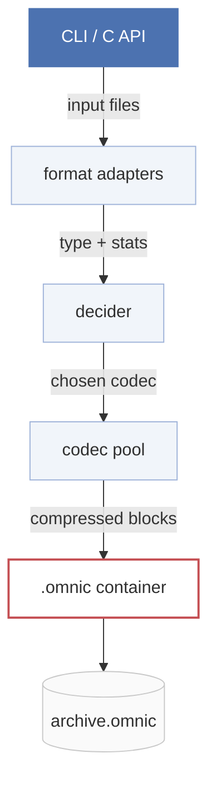

# omnic

**One binary for 14 compression formats.** omnic opens any of them, picks the
right codec for every file it compresses, and — by default — packs whole
directory trees into archives that come out smaller than zip and faster to
make, and that lose one block to a bad byte instead of the whole tree.

[](https://github.com/push-rock/omnic/actions/workflows/ci.yml)
[](https://github.com/push-rock/omnic/releases)
[](LICENSE)

Linux · macOS · Windows — one static binary, no runtime dependencies

[English](README.md) | [简体中文](README.zh-CN.md)

[Get it](#get-it) · [Usage](#usage) · [Why](#why-omnic) · [Results](#measured-results) · [Limits](#what-it-doesnt-do-yet) · [Codecs](#supported-codecs) · [Under the hood](#under-the-hood) · [Build](#build)

Real output, abridged:

```console
$ omnic pack gamedir/ -o gamedir.omnic             # 8,586 files: PNG, Lua, Ogg, DLLs
      block: zstd/6  40812803 -> 8739258 bytes (21.41%)
      block: zstd/9  30225166 -> 9884335 bytes (32.70%)
    gamedir/: 152644069 -> 100395194 bytes (65.77%), 1.55s

$ omnic analyze -x libc++.dll game.lua air.png     # how it decided, file by file
libc++.dll: executable | entropy 6.43 | -> zstd level 9
game.lua: text/natural | entropy 4.86 | -> zstd level 6
air.png: already compressed | entropy 5.71 | -> skip level 0

$ omnic d xray.lzfse                               # a format your other tools don't open
xray.lzfse: lzfse | balanced

$ omnic unpack gamedir.omnic --verify              # is this archive still good?
verified 8586/8586 entries, 4 blocks OK
```

## At a glance

omnic is built for mixed trees — game assets, project folders, build output:
every file gets the codec that suits it, and already-compressed files pass
straight through. It also opens the formats your other tools don't. Not there
yet: encryption, a GUI, ACLs and full tar replacement — all of them will
follow in later versions. The complete list of today's edges is in
[What it doesn't do](#what-it-doesnt-do-yet).

- **Opens 14 formats.** gzip, zlib, raw deflate, zstd, xz, lzma, lzip, bzip2,
  lz4, brotli, snappy, compress (`.Z`) and Apple's lzfse/lzvn. 16 codecs are
  built in — three of them interchangeable gzip engines — and 12 of them
  compress as well as decompress.
- **Packs a mixed tree smaller than zip, faster.** A real 152.6 MB game tree
  (8,586 files): 95.7 MB against zip's 100.7 MB, in 1.55 s against 3.86 s.
  On the Silesia corpus: 10.0% smaller at 6.6× the pack speed.
- **Reaches 7-Zip's maximum ratio.** Its `best_ratio` profile lands within
  0.05 percentage points of `7z -mx=9` on Silesia while packing 1.5× faster
  and unpacking 2.3× faster.
- **Bounds the damage from a bad byte.** Files that compress alike are
  compressed together into a block (up to 64 MiB), and every block carries a
  CRC. One flipped bit costs one block — no more: the lost files are named,
  everything else still extracts.
- **Leaves already-compressed files alone.** On that game tree, 4,069
  already-compressed assets — mostly PNG and Ogg — pass through untouched;
  the CPU goes to the files that can shrink.
- **Explains itself.** Every file is classed in about 1 ms, and `analyze -x`
  prints the class, the entropy (bits per byte; 8 is random) and the codec it
  chose.


## Get it

**Windows (scoop)**

```console
scoop bucket add omnic https://github.com/push-rock/omnic-bucket
scoop install omnic
```

**Linux, macOS, Windows** — take the binary for your platform from the
[latest release](https://github.com/push-rock/omnic/releases/latest): about
1 MB to download, no installer, no runtime dependencies. It is `bin/omnic`
inside the archive
(`bin\omnic.exe` on Windows); put it on your `PATH`. Every release is built
and fully tested by CI on the tagged commit. Prefer to build it? See
[Build](#build).

<details>
<summary>The binaries are not code-signed</summary>

- **Windows** — running from cmd/PowerShell is unaffected by SmartScreen; if you launch by double-clicking and get the blue warning, pick *More info → Run anyway*.
- **macOS** — extracting from a terminal (`tar -xzf`) leaves no quarantine flag, the binary runs as-is; if you extract by double-clicking (Archive Utility), clear the flag once: `xattr -d com.apple.quarantine bin/omnic`.

</details>

## Usage

```console
omnic c notes.txt                                  # auto codec → notes.txt.zst; replaces the source (like gzip — add -k to keep it)
omnic d notes.txt.zst                              # the format is detected from the bytes
omnic pack project -o project.omnic                # speed profile: already smaller than zip
omnic pack project -o project.omnic -p best_ratio  # ratio profile: smallest archives
omnic unpack project.omnic                         # extracts into project.omnic_out/ (-C picks another directory)
omnic unpack project.omnic --list                  # name, size, codec, ratio — without reading the data
omnic unpack project.omnic --file src/main.c       # one entry out (exact path, dir/ prefix, or *.ext)
omnic unpack project.omnic --verify                # is this archive still good? Writes nothing.
```

The profile is the one choice omnic asks you to make:

| `-p` | optimises for | tends to pick |
|---|---|---|
| `fast_compress` | the shortest compress time | snappy, zstd `--fast` |
| `fast_decompress` | the fastest decode | snappy, lz4, zstd |
| `balanced` *(default)* | the middle of the curve | zstd |
| `best_ratio` | the smallest output | xz, brotli |

<details>
<summary>Full <code>omnic --help</code></summary>

```console
omnic - universal compressor (auto-selects the best codec per file type)

usage:
  omnic c   [options] <file...>    compress (auto codec unless -c)
  omnic d   [options] <file...>    decompress (auto format by magic/ext; .omnic archives too)
  omnic pack   [options] <dir>     pack a directory tree into a .omnic archive
  omnic unpack [options] <archive> extract a .omnic archive
  omnic analyze <file...>          show type/entropy/decision without compressing
  omnic list                       list codecs and supported formats
  omnic version | help

options:
  -p, --profile <v>   fast_compress | fast_decompress | best_ratio | balanced (default)
  -c, --codec <name>  force a codec (see: omnic list; overrides skip, not for pack)
  -l, --level <n>     codec-native level
  -T, --threads <n>   worker threads (classify, zstd/xz compress, unpack writers)
  -o, --output-dir <dir>  pack: output archive path; unpack: output dir (same as -C)
  -C, --dir <dir>     unpack: output root directory
  -f, --force         overwrite output; compress incompressible data anyway
  -k, --keep          keep the source file (default: remove after success)
  -x, --explain       print the decision rationale
  -q, --quiet
  --per-file          pack: one block per file (fast single-file extract)
  --no-skip           pack: compress already-compressed assets too
  --strict            pack: fail if any entry had to be skipped (links, special files)
  --ctime             pack: also store creation times
  --xattr             pack: also store POSIX extended attributes
  --exclude <pattern> pack: leave out matching entries (repeatable; dir/ drops the subtree)
  --mirror            pack: keep a second copy of the index so a truncated archive still yields its intact files
  --block-size <MiB>  pack: solid block limit, 1..1024 (default 64)
  --file <pattern>    unpack: extract entries (exact path, dir/ prefix, or * glob; repeatable)
  --list              unpack: list entries without extracting
  --verify            unpack: verify archive without extracting
```

</details>

## Why omnic

Every archiver that welds itself to one algorithm inherits that algorithm's
blind spots. The best codec depends on the content — by up to 4× between the
right and the wrong pick on a single file — so omnic doesn't pick one.

1. **The decision is the product.** omnic samples each file (head, middle and
   tail, 256 KiB each), extracts 8 features and looks up a class × profile
   policy table, fitted offline and gated by a leave-one-out regret bound.
   Content outranks the file name: a renamed PNG still passes through, text
   named `.jpg` still compresses. You shouldn't have to know what your data is.
2. **Standard streams in, standard streams out.** What omnic writes in
   single-file mode is a plain gzip, xz, zstd or brotli stream that any tool
   can read; what other tools wrote, omnic reads. Nothing is locked in.
3. **A container built to outlive its codecs.** A `.omnic` archive is a thin
   layout of blocks, an index and two CRC layers. Each block records the codec
   that produced it, so archives written today already accept codecs that
   don't exist yet — and a faster decoder next year speeds up the archives you
   already own. The complete format fits on one page: [FORMAT.md](FORMAT.md).

## Measured results

One machine (i7-12700, 12 cores / 20 threads, Windows, NVMe SSD), one window,
every competitor measured alongside omnic in the same session: 7-Zip 26.06,
the system tar (bsdtar: zip and gzip), and codec-native levels through omnic's
own vendored libraries (`-c <codec> -l <level>`). Best of 3 (best of 7 for
millisecond-scale extraction).
`omnic_bench` and `omnic_gamepack`, built with the project, reproduce omnic's
rows; the competitor rows are the stock commands named in each table, run at
their stock settings — thread counts were not equalised. Ratio and pack are
one window; **unpack** was measured the same way in a later one: the wall
clock of a full extraction into a fresh directory, best of 5, every tool
interleaved.

### Archives: two corpora, every profile

Silesia (202 MiB, 12 domain-mixed files, no extensions — every decision goes
through content sampling):



Game tree (152.6 MB, 8,586 real files — Luanti 5.16 + minetest_game +
VoxeLibre: PNG textures, Lua scripts, Ogg audio, models, fonts, DLLs):


- **Default profile.** omnic's default is a speed profile, and it still lands
  10% smaller than zip at 6.6× the pack speed on Silesia — 5.0% smaller at
  2.5× on the game tree.
- **Max profile.** `best_ratio` ties `7z -mx=9` to within 0.05 percentage
  points on Silesia while packing 1.5× faster: files headed for the same
  codec are compressed together in solid blocks, so cross-file redundancy
  isn't lost. On the game tree 7-Zip is 5 percentage points smaller; it wins
  there, recorded as such. `--no-skip` is the ratio sprint: 62.2%.
- **The speed end.** `fast_compress` is a speed profile, not a ratio profile:
  41% on Silesia against zip's 32%. It is the right one when the input is
  mostly already-compressed assets (the game tree: 1.40 s, 69.71% against
  zip's 69.20%).
- **Extraction.** One member out of 8,586 entries takes 8.8 ms from a
  `--per-file` archive (zip: 26.9 ms); from a solid archive 54 ms, because it
  decodes the whole block (104 ms for the 10 MB `dickens`, against zip's
  28 ms). A full unpack of Silesia runs 0.20 s against zip's
  0.38 s and 7-Zip's 0.93–1.43 s; on the game tree it is 4.08 s against zip's
  2.64 s and 7-Zip's 6.41–6.50 s. `--verify` walks both CRC layers at about
  1 GB/s without writing a
  byte; `--list` reads 8,586 entries in 7.5 ms.
- **Corruption isolation.** One byte flipped inside the game-tree archive:

  ```console
  $ omnic unpack gamedir.omnic              # one byte inside this archive was flipped
  omnic: block 0 (fmt 0) corrupted — checking entries one by one, affected: luanti-5.16.1-win64/textures/base/pack/air.png …
  omnic: entry corrupted — skipped: luanti-5.16.1-win64/textures/base/pack/aux1_btn.png
  omnic: extracted 8585/8586 entries (1 failed)
  $ echo $?
  2
  ```

  That byte landed in a store block holding 1,151 already-compressed files.
  The block's checksum failed, but every file carries its own, so the
  unpacker checked all 1,151 and wrote the 1,150 that passed. The damaged one
  is named, the exit code says 2, and nothing else was held hostage. Damage
  inside a *compressed* block still costs that block — up to 4,233 files in
  this archive — which is why `--per-file` and `--block-size` exist; see
  [Limits](#what-it-doesnt-do-yet).

<details>
<summary>Raw numbers behind both charts</summary>

Silesia (202 MiB):

| option | ratio | archive size | vs zip | pack | unpack |
|---|---|---|---|---|---|
| zip (deflate, bsdtar) | 32.18% | 65.0 MB | — | 4.99 s | 0.38 s |
| 7z -mx=5 (its default) | 23.40% | 47.3 MB | -27.3% | 21.6 s | 0.93 s |
| **7z -mx=9 (its max)** | **22.97%** | 46.4 MB | **-28.6%** | 46.3 s | 1.43 s |
| **omnic fast_compress** | 41.01% | 82.9 MB | +27.5% | **0.34 s** | 0.20 s |
| **omnic fast_decompress** | 31.38% | 63.4 MB | -2.5% | 0.44 s | 0.20 s |
| **omnic pack (default)** | **28.97%** | **58.6 MB** | **-10.0%** | **0.76 s** | **0.20 s** |
| **omnic -p best_ratio** | **23.02%** | **46.5 MB** | **-28.5%** | **30.2 s** | **0.62 s** |

Game tree (152.6 MB):

| option | ratio | archive size | vs zip | pack | unpack |
|---|---|---|---|---|---|
| zip (deflate, bsdtar) | 69.20% | 100.7 MB | — | 3.86 s | 2.64 s |
| 7z -mx=5 | 58.73% | 85.5 MB | -15.1% | 13.4 s | 6.41 s |
| **7z -mx=9** | **58.24%** | **84.7 MB** | **-15.8%** | 14.9 s | 6.50 s |
| **omnic fast_compress** | 69.71% | 101.5 MB | +0.7% | **1.40 s** | 3.72 s |
| **omnic fast_decompress** | 66.54% | 96.9 MB | -3.8% | **1.52 s** | 4.21 s |
| **omnic pack (default)** | **65.77%** | **95.7 MB** | **-5.0%** | **1.55 s** | **4.08 s** |
| **omnic --per-file** | 68.43% | 99.6 MB | -1.1% | **1.47 s** | 4.03 s |
| **omnic -p best_ratio** | 63.22% | 92.0 MB | -8.6% | **11.3 s** | 4.49 s |
| **omnic --no-skip** | **62.17%** | **90.5 MB** | **-10.2%** | 12.5 s | 4.71 s |

</details>

### Single files and single streams

omnic ships no new algorithm: single-file mode routes to a codec — `best_ratio`
on one file is xz-6, which beats `zstd -19` and trails `7z -mx=9` on most
files. It catches up with 7-Zip only in the archive: `best_ratio` ties
`7z -mx=9` on Silesia and stays 5 percentage points behind on the game tree.
The 202 MiB Silesia corpus as a plain tar, compressed by everything we could
run. X axis is compress time (log scale), Y axis is ratio — the lower-left
corner wins:


- **The ladder brackets the frontier**: `fast_compress` ties lz4 at the speed end, `balanced` (zstd-9, multithreaded) owns the middle, `best_ratio` (xz-6) holds the ratio end against 7-Zip's LZMA2.
- **Famous fixed settings are strictly dominated**: zstd -19 (slower *and* larger than omnic's xz-6 pick), brotli -11 (260 s — 4× slower than best_ratio for a worse ratio), every zip/deflate tier (slower and larger than balanced).

Decode side, same streams:


The ladder holds on the decode side too — snappy-class decode (1.1 GB/s) for
the fast profiles (tying lz4), zstd-class for balanced, xz-class at the ratio
end. The single-stream ratio race still goes to `7z -mx=9` and `xz -9`. The
16-configuration table behind both charts, per-file picks against every zip
tier, and the Kraken comparison are in [BENCHMARK.md](BENCHMARK.md).

## What it doesn't do (yet)

The edges as of v0.3.3 — read this before trusting it with a backup.

- **Not a full tar replacement yet.** No ACLs, no NTFS alternate data
  streams, no encryption — all slated for later versions. 7-Zip's format
  breadth and 25 years of maturity are things omnic does not have yet.
- **Links, permissions, owners and xattrs are kept.** Symlinks, junctions
  and hard links round-trip, and so do POSIX permission bits and the
  Windows read-only, hidden and system attributes. `--ctime` adds creation
  times, `--xattr` POSIX extended attributes; file owners are always stored
  and restored when you unpack as root (a plain user gets the files under
  their own name and a note, as with `tar`). All of that lives in an
  optional area older readers simply skip: they still extract every file.
  `--exclude` leaves matching entries out (`*.o`, `node_modules/`).
  FIFOs, device files and reparse points omnic does not understand are left
  out too, and `pack` says so — how many, of which kind, and the first eight
  names; `--strict` turns that into a failure (exit code 2) and writes
  nothing. Creating a file symlink on Windows needs Developer Mode or
  administrator rights; without them those entries are reported as failed.
- **Only file times are restored.** A directory's modification time is not:
  writing files into a directory updates it, so only an empty directory could
  keep its original time. Rather than restore it half the time, omnic
  restores it never.
- **It doesn't open zip, 7z or rar archives.** The 14 formats are single-stream
  compression formats; the archive omnic writes and reads is its own, `.omnic`.
- **Archives need a current omnic on both ends.** The format is v2 since this
  version; omnic 0.3.x refuses a v2 archive with "needs a newer omnic".
  Archives written by 0.3.x stay readable.
- **By default the index is a single copy at the tail of the file.** A
  truncated or tail-damaged archive is then refused outright — isolation
  covers damage inside the data blocks. `pack --mirror` keeps a second copy
  right after the header instead: a truncated archive still lists everything
  and yields every block the truncation did not cut into. It costs space
  (+0.87 % on the game tree) and such archives need a current omnic, so it
  is off unless you ask.
- **The blast radius of damage in a compressed block is that block, and a
  block can be big.** Blocks hold up to 64 MiB (`--block-size 1..1024`),
  which for trees of small files means thousands of files: in the archive
  above, the largest block holds 4,233. Damage in a store block costs only
  the files it actually touched. In fairness: zip loses only the single
  damaged file, while a single-stream `tar.xz` or a solid 7z loses
  everything after a bad byte. omnic sits in between, at block granularity —
  and the block size is yours to choose. `--per-file` gives every
  *compressed* file its own block; already-compressed files keep sharing
  store blocks, but those are the ones that get salvaged file by file.
- **A single stream still squeezes harder.** `tar | xz -9` reached 56.8% on
  the game tree (v0.3.3 window) against `best_ratio`'s 63.2% — and gives up
  the per-file routing, the pass-through and the millisecond single-file
  extraction.
- **Unpacking many small files on Windows is slower than tar**: 3.2 s against
  1.8 s for the 8,586-file tree when first measured, 4.08 s against 2.64 s in
  the later window behind the chart — this figure swings by a third between
  sessions. The engine is 0.12 s of that; the rest is file creation, mostly
  Defender scanning each file an unsigned process writes (a bare robocopy of
  the same tree costs 3.7 s, 3.9 s in that later window). With the output
  directory excluded from Defender it drops to about 1.8 s. On Linux and
  macOS there is no such tax.
- **Some formats need their extension.** brotli and raw deflate carry no
  magic number at all; snappy and lzfse are matched by extension today.

## Supported codecs

16 codecs, one shared adapter interface (`src/codec/ac_*.c`) — adding one is a
single file plus a registry entry.

<details>
<summary>Codec table — versions, extensions, levels</summary>

| codec | format | levels | notes |
|---|---|---|---|
| zstd 1.5.7 | .zst | -5..22 | multithreaded |
| lz4 1.10.0 | .lz4 | 0..12 | level 0 = fast mode, 1..12 = LZ4HC |
| xz 5.8.4 | .xz | 0..9 | CRC64; multithreaded with -T |
| zlib 1.3.2 | .gz | 0..9 | streaming, multi-member gzip on decompress |
| zlib-ng 2.3.3 | .gz | 0..9 | same format, faster implementation |
| libdeflate 1.26 | .gz | 0..12 | whole-buffer API, highest gzip speed |
| brotli 1.2.1 | .br | 0..11 | |
| snappy 1.3.1 | .snappy | 1..2 | official framing format (magic + CRC32C + 64 KB chunks) |
| lzfse 1.0 | .lzfse | — | single speed point |
| zlib-stream | .zlib | 0..9 | RFC 1950 wrapper, same zlib library |
| raw-deflate | .zz | 0..9 | headerless deflate, recognized by extension; no checksum — corrupted streams can decode silently (format-inherent) |
| lzma | .lzma | 0..9 | lzma-alone container, via liblzma |
| lzvn | .lzvn | decode only | "bvn" streams, shares the lzfse block decoder |
| lzip | .lz | decode only | lzip container (v0/v1), via liblzma, multi-member |
| bzip2 1.0.8 | .bz2 | decode only | vendored decode half, concatenated streams |
| compress | .Z | decode only | LZW (ncompress semantics), self-contained decoder |

</details>

## Under the hood

The pack path is a pipeline: identify each file, pick its codec, compress,
and write CRC-checked blocks.

- **Deterministic by construction.** Parallel and serial runs produce
  byte-identical archives — `-T 1` equals `-T 8`, enforced by a CI test.
- **Threaded where it pays.** A classify pool walks the tree, a worker pool
  compresses blocks, a decode pool runs ahead of extraction, a write pool puts
  files on disk. The whole tree runs clean under ThreadSanitizer in CI.
- **Small enough to read.** C11, with the 16 codecs vendored and statically
  linked; engine, decider and CLI together are about 7,000 lines.
- **The spec is the contract.** [FORMAT.md](FORMAT.md) is the byte-level
  definition of `.omnic` — enough to write an independent decoder.

<details>
<summary>Pack pipeline</summary>



**format adapters** identify each file — magic bytes first, file extension as
the fallback; the **decider** picks the codec per file in about 1 ms; the
**codec pool** compresses with 16 vendored codecs; the **.omnic container**
writes blocks, index and double CRC. `d` / `unpack` runs the same pipeline in
reverse.

</details>

## Build

Requires CMake ≥ 3.16 and a C11 compiler (MSVC / GCC / Clang). All codecs are vendored — no system dependencies.

```bash
cmake -B build -DCMAKE_BUILD_TYPE=Release
cmake --build build -j
./build/omnic list
ctest --test-dir build
```

## License

MIT. Vendored codecs keep their own licenses, see `THIRD_PARTY_NOTICES.md`. No GPL/LGPL code is linked by default (`OMNIC_ENABLE_GPL` is reserved for optional builds).
