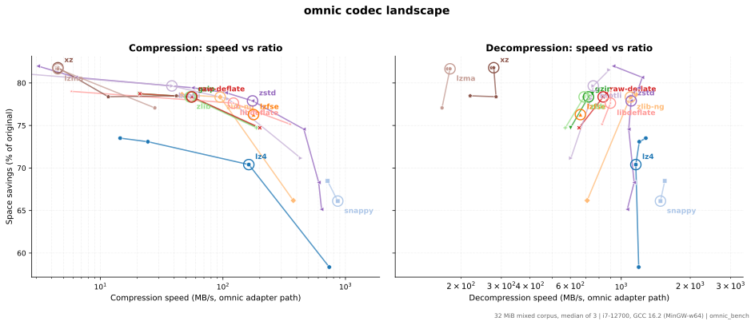

# omnic

**通用压缩器** —— 一个二进制，自动为每个文件挑选最合适的压缩算法，并且能解开市面上绝大多数压缩格式。

[English](README.md) | [简体中文](README.zh-CN.md)

```
$ omnic c report.json
report.json: zstd | balanced | text | level 8
    1048576 -> 91234 bytes (8.70%), 0.091s, 11.5 MB/s

$ omnic c --profile best_ratio report.json
report.json: brotli | best_ratio | text | level 11
    1048576 -> 61042 bytes (5.82%), 0.322s, 3.3 MB/s

$ omnic d report.json.xz
report.json.xz: xz
    61042 -> 1048576 bytes, 0.019s, 55.2 MB/s
```

## 为什么做这个项目

lzbench 基准测试收录了 50 多种压缩器，但没有任何主流工具在它们之间做路由。`zstd --adapt` 只在单一算法内部自适应级别；7-Zip 不关心输入是 JSON 还是位图。omnic 补上这一环：

- **压缩**：先识别输入（后缀 + 4MB 熵采样），再查决策表 —— *7 种数据类型 × 4 种偏好模式* —— 得到 `(算法, 级别)`；
- **偏好**：`--profile fast_compress | fast_decompress | best_ratio | balanced`（快压 / 快解 / 高压缩率 / 均衡）；
- **解压**：魔数（magic number）优先识别格式、后缀兜底。输出只用各算法原生格式，任何第三方工具都能解开；
- **跳过不可压缩数据**：已压缩输入（jpeg/zip/…）和高熵数据（≥7.5 bits/byte）默认跳过并警告；`--force` 强制压缩。

## 构建

需要 CMake ≥ 3.16 和 C11 编译器（MSVC / GCC / Clang）。所有算法库均已内置（vendored），无系统依赖。

```bash
cmake -B build -DCMAKE_BUILD_TYPE=Release
cmake --build build -j
./build/omnic list
ctest --test-dir build
```

## 用法

```
omnic c   [选项] <文件...>     压缩（默认自动选算法，-c 可指定）
omnic d   [选项] <文件...>     解压（魔数/后缀自动识别格式）
omnic analyze <文件...>        只分析类型/熵/决策，不产生副作用
omnic list                     列出算法与支持的格式

-p --profile <v>   fast_compress | fast_decompress | best_ratio | balanced
-c --codec <名>    指定算法                  -l --level <n>  算法原生级别
-T --threads <n>   压缩线程数（zstd）        -o --output-dir <目录>
-f --force    覆盖已存在输出 / 强制压缩不可压缩数据
-k --keep     保留源文件（默认：成功后删除）
-x --explain  打印决策依据                   -q --quiet
```

## 算法清单

| 算法 | 格式 | 级别 | 说明 |
|---|---|---|---|
| zstd 1.5.7 | .zst | -5..22 | 支持多线程 |
| lz4 1.10.0 | .lz4 | 0..12 | 级别 0 = fast 模式，1..12 = LZ4HC |
| xz 5.8.4 | .xz | 0..9 | CRC64 校验 |
| zlib 1.3.2 | .gz | 0..9 | 流式编解码，解压支持多 member 拼接流 |
| zlib-ng 2.3.3 | .gz | 0..9 | 同格式更快实现，非兼容模式（zng_ 前缀）共存 |
| libdeflate 1.26 | .gz | 0..12 | 整块 API，gzip 速度上限 |
| brotli 1.2.1 | .br | 0..11 | |
| snappy 1.3.1 | .snappy | 1..2 | 官方 framing 格式（magic + CRC32C + 64KB 分块） |
| lzfse 1.0 | .lzfse | — | 单一速率点 |
| zlib-stream | .zlib | 0..9 | RFC 1950 包装，同一 zlib 库 |
| raw-deflate | .zz | 0..9 | 无头 deflate 流，后缀识别；无校验和，损坏流可能静默错解（格式固有） |
| lzma | .lzma | 0..9 | lzma-alone 容器，走 liblzma |
| lzvn | — | 仅解码 | "bvn" 流，与 lzfse 共用块解码器 |
| lzip | .lz | 仅解码 | lzip 容器（v0/v1），走 liblzma，多 member |
| bzip2 1.0.8 | .bz2 | 仅解码 | vendored 解码半边，串接流 |
| compress | .Z | 仅解码 | LZW（ncompress 语义），自研解码器 |

所有适配器共用一套接口（`src/codec/ac_*.c`），新增算法 = 一个适配器文件 + 一条注册表项。解压覆盖全部 14 种格式：gzip（多 member）、zlib、raw deflate、zstd、xz、lzma、lzip、bzip2、lz4、brotli、snappy、compress（.Z）、lzfse、lzvn——魔数优先识别，后缀兜底。

## 性能



各压缩器的"速度 × 压缩比"全景，走 omnic 流式适配层在 [Silesia 标准语料](https://sun.aei.polsl.pl/~sdeor/index.php?page=silesia)上实测（212 MiB、12 个真实文件；3 轮取中位）。随构建自带的工具可复现：

```
omnic_bench --rounds 3 --csv bench.csv --corpus silesia/dickens --corpus silesia/mozilla ...（12 个文件）
python tools/plot_bench.py bench.csv -o assets/bench
```

`omnic_bench` 同时在同一份数据上对比"直连裸库"与"走适配层"的吞吐：**Silesia 上压缩损耗全算法 ≤0.8%、解压 ≤1.4%**（参考机：i7-12700、GCC 16.2 MinGW-w64；原始数据见 `assets/bench.csv`）。多数解压路径走 omnic 反而**更快**（最高 +60%：zstd 低档、lz4、snappy）：适配层的定长分块缓冲天然缓存友好，而一次性基线在比 L3 更大的缓冲间穿行。这份余量不是白来的——整块式 codec 的 seek 预估分配、小块格式的 1 MiB stdio 缓冲、snappy framing 的 CRC32C 硬件指令化（SSE4.2/ARM64）、lzfse 的块头预扫精确分配，四处优化各守一段。`ctest` 每次提交跑 40% 量级冒烟门禁（`bench_smoke`，合成语料——CI 自包含可复现）；紧验收线由本地跑同一工具把关。

## 决策是怎么做的

决策表编译进二进制（`src/policy/policy_table.gen.c`），初值来自 lzbench 实测数据，并可由离线训练管线（`tools/train`，Python：`bench.py` → CSV → `fit.py` → C 决策表）用真实数据重新生成。决策过程就是查表 —— 微秒级，无任何模型运行时依赖。

## 许可证

MIT。内置的各算法库保留其原始许可证，见 `THIRD_PARTY_NOTICES.md`。默认不链接任何 GPL/LGPL 代码（`OMNIC_ENABLE_GPL` 预留给可选构建）。
