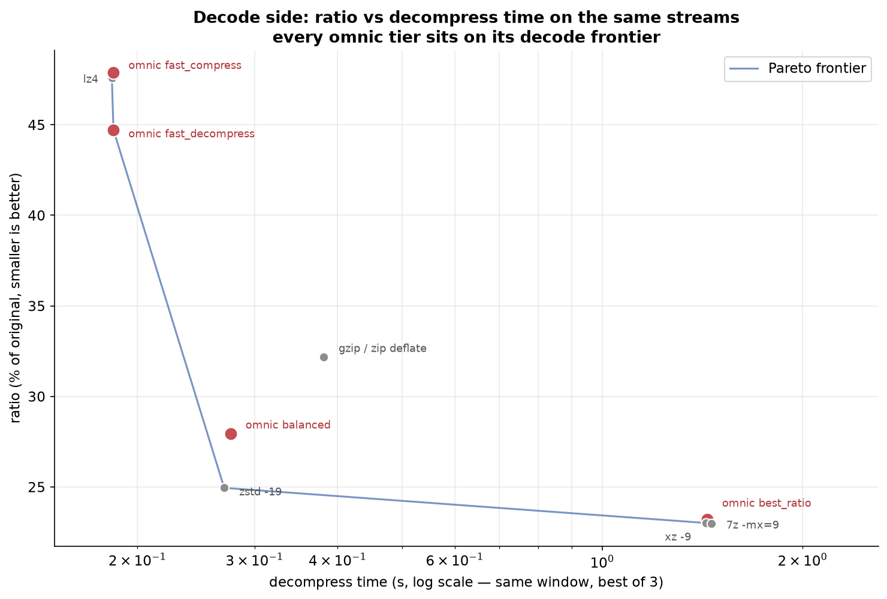

# omnic

**一个容器装下所有压缩算法。** omnic 是通用压缩器：识别解压 14 种主流格式，~1 ms 内为每个文件自动选对算法；整树打包的默认档对 zip 双轴全胜——体积小 10%、打包快 6.6 倍——极限档与 7-Zip 最大档压缩率打平、速度快 1.5 倍。

[English](README.md) | [简体中文](README.zh-CN.md)

[](https://github.com/push-rock/omnic/actions/workflows/ci.yml)

```
$ omnic c report.json
report.json: zstd | balanced | text/code | level 9
    527565 -> 45995 bytes (8.72%), 0.007s, 75.0 MB/s

$ omnic c report.json -p best_ratio
report.json: xz | best_ratio | text/code | level 9
    527565 -> 32108 bytes (6.09%), 0.110s, 4.8 MB/s

$ omnic pack gamedir/
gamedir/: 152644069 -> 100395194 bytes (65.77%), 1.55s

$ omnic unpack backup.omnic --verify
verified 12/12 files, 4 blocks OK
```

## 获取

**Windows（scoop）**：

```
scoop bucket add omnic https://github.com/push-rock/omnic-bucket
scoop install omnic
```

**winget**：`winget install push-rock.omnic`（包提交审核中——落地前用 scoop 或下面的二进制）。

**Linux / macOS / Windows** 预编译二进制挂在每个 [GitHub Release](https://github.com/push-rock/omnic/releases)，免安装、零运行时依赖。可执行文件在归档内的 `bin/omnic`（Windows 为 `bin\omnic.exe`），放进 `PATH` 即可。一页看完所有实测数字：[BENCHMARK.md](BENCHMARK.md)。

二进制未做代码签名（开源预算）：

- **Windows** —— 从 cmd/PowerShell 调用不受 SmartScreen 影响；双击运行若弹出蓝色警告，选 *更多信息 → 仍要运行*。
- **macOS** —— 终端 `tar -xzf` 解压不会带隔离标记，直接可用；若用双击（归档实用工具）解压，清一次标记：`xattr -d com.apple.quarantine bin/omnic`。

二进制由 CI 在 tag 提交上构建并全量测试后才挂出。从源码构建见 [构建](#构建)。

## 为什么用 omnic

**目标是给整个压缩动物园一个统一的容器。** 当下通行的每种归档格式都把自己焊死在一个算法上——于是继承了那个算法的天花板、盲区和过时日程。omnic 押注相反的形状：一个**薄而冻结的容器**，只管块布局、条目索引和两层 CRC（字节级完整定义见 [FORMAT.md](FORMAT.md)），而**每一路 codec 都是里面可替换的零件**。

由此换来四个性质——每一个都是设计决策，不是附赠：

- **全格式、双向兼容。** 内置 16 个 codec，识别解压 14 种主流格式：gzip、zstd、xz、brotli、lzip、bzip2、苹果 lzfse/lzvn、1989 年的 compress(.Z)——魔数优先，后缀兜底。世界丢给你什么，omnic 都能开；omnic 单文件模式写出的就是标准流，任何工具都能读。后向兼容是这个新容器立足的地板。
- **向前探索、不被锁死。** 容器记录每个块出自哪个 codec，所以今天写下的归档已经能接纳明天才出现的算法；明年某个 codec 变快了，你手里每个归档的解压都免费受益。算法竞赛变成你的分红，而不是你的迁移成本。
- **决策即产品。** 最优算法随内容而变——同一个文件，选对与选错可以差 4 倍。omnic 用 ~1 ms 的逐文件判定（三段采样 + 8 维特征 + 7 个内容类；决策表通过留一 regret 界才允许发布）替你每次选对。你不需要知道你的数据是什么。
- **实测帕累托，不靠嘴。** 四个档位构成速度/压缩率阶梯。在两个基准语料上，这个阶梯卡住所有受测主流压缩器的帕累托前沿——而那些著名固定档（zstd -19、brotli -11、zip/deflate 全家）被严格支配。图表、原始数字、以及还剩下的输面，全部见[实测结果](#实测结果)。

坏块隔离——一个比特翻转只废一个块、点名受影响文件、其余照常解出——是容器设计的自然结果，实测章节有覆盖。

## 架构

```
                      +---------------------------------------+
                      |            CLI  /  C API             |
                      |   c  d  pack  unpack  analyze  list   |
                      +-------------------+-------------------+
                                          |
            +-----------------------------+-----------------------------+
            |                             |                             |
  +---------v---------+     +-------------v-------------+   +-----------v-----------+
  |     决策器         |     |    .omnic 容器 v1         |   |    格式适配层          |
  |  ~1 ms / 文件      |     |  块 | 索引 | 双层 CRC     |   |  14 路魔数嗅探，       |
  | 三段采样,          |     |  (冻结规格: FORMAT.md)    |   |  魔数优先、后缀兜底    |
  | 8 维特征,          +---->+  solid / per-file / skip |   +-----------+-----------+
  | 7 个内容类         |     |  坏块隔离                 |               |
  +---------+---------+     +-------------+-------------+               |
            |                             |                             |
            +-----------------------------+-----------------------------+
                                          |
              +---------------------------v---------------------------+
              |             codec 池 — 16 个内置算法                    |
              | zstd* lz4 xz* lzma zlib x3 brotli snappy lzfse ...     |
              |        (* 压缩经 worker 池多线程)                      |
              +-----------------------------------------------------+
                统一适配器接口 (src/codec/ac_*.c)：新增算法
                = 一个适配器文件 + 一条注册表项
```

- **pack**：分类池（8 worker）遍历目录树，按压缩亲和性分桶，主线程构块，第二个 worker 池压块、按派发序写出——并行与串行产物逐字节相同。
- **unpack**：解码池超前解块，主循环按序收割条目、过 CRC，交给写盘池（≥32 条目或 ≥8 MiB 时启用）；CRC-32 走 slice-by-8。
- omnic 自身的数字全部可复现：`omnic_bench`（codec 级）与 `omnic_gamepack`（打包级）随构建附带。

## 支持的压缩协议

| codec | 格式 | 级别 | 说明 |
|---|---|---|---|
| zstd 1.5.7 | .zst | -5..22 | 支持多线程 |
| lz4 1.10.0 | .lz4 | 0..12 | 级别 0 = fast 模式，1..12 = LZ4HC |
| xz 5.8.4 | .xz | 0..9 | CRC64 校验；`-T` 多线程 |
| zlib 1.3.2 | .gz | 0..9 | 流式编解码，解压支持多 member 拼接 |
| zlib-ng 2.3.3 | .gz | 0..9 | 同格式更快实现 |
| libdeflate 1.26 | .gz | 0..12 | 整块 API，gzip 速度天花板 |
| brotli 1.2.1 | .br | 0..11 | |
| snappy 1.3.1 | .snappy | 1..2 | 官方 framing 格式（magic + CRC32C + 64KB 分块） |
| lzfse 1.0 | .lzfse | — | 唯一速度点 |
| zlib-stream | .zlib | 0..9 | RFC 1950 封装，同一 zlib 库 |
| raw-deflate | .zz | 0..9 | 无头 deflate，按后缀识别；无校验和——损坏流可能静默解出（格式固有） |
| lzma | .lzma | 0..9 | lzma-alone 容器，走 liblzma |
| lzvn | .lzvn | 仅解压 | "bvn" 流，与 lzfse 共用块解码器 |
| lzip | .lz | 仅解压 | lzip 容器（v0/v1），走 liblzma，多 member |
| bzip2 1.0.8 | .bz2 | 仅解压 | 内置解码半边，支持拼接流 |
| compress | .Z | 仅解压 | LZW（ncompress 语义），自包含解码器 |

所有适配器共用一套接口（`src/codec/ac_*.c`），新增算法 = 一个适配器文件 + 一条注册表项。

## 使用方案

```
omnic c   [选项] <文件...>     压缩（默认自动选算法，-c 可指定）
omnic d   [选项] <文件...>     解压（魔数/后缀自动识别格式；.omnic → 整树）
omnic pack   [选项] <目录>     把目录树打包成一个 .omnic 归档
omnic unpack [选项] <归档>     解开 / 列出 / 校验 .omnic 归档
omnic analyze <文件...>        只分析类型/熵/决策，不产生副作用
omnic list                     列出算法与支持的格式

-p --profile <v>   fast_compress | fast_decompress | best_ratio | balanced
-c --codec <名>    指定算法                  -l --level <n>  算法原生级别
-T --threads <n>   线程数（分类；zstd/xz 压缩；解包写盘）  -o --output-dir <目录>
-f --force    覆盖已存在输出 / 强制压缩不可压缩数据 / --file 目标已存在
-k --keep     保留源文件（默认：成功后删除）
-x --explain  打印决策依据                   -q --quiet

pack:   --per-file  每文件一块（毫秒级单文件提取，压缩率稍差）
        --no-skip   已压缩资产也压（默认直通存储）
        --block-size <MiB>  solid 块上限，1..1024（默认 64）
unpack: --file <模式>  提取匹配条目（精确路径 / 目录前缀 / * 通配；可重复）
        --list         只列 名字/大小/算法/压缩率，不碰数据区
        --verify       校验两层 CRC，不写盘
        -C --dir <目录> 输出根目录
```

## 实测结果

同一台机器（i7-12700）、同一个测量窗口：7-Zip 26.06、系统 tar（bsdtar，zip/gzip）、以及 omnic 自带库的原生级别（`-c <算法> -l <级别>`），全部与 omnic 在同一会话内交替实测。快档取 3 轮最优（毫秒级提取取 7 轮）。`omnic_bench` 与 `omnic_gamepack` 复现 omnic 的行；对手行就是各表中标明的原生命令。

### 单流对决：帕累托全景

202 MiB 的 Silesia 语料打成裸 tar，能用上的压缩器全压一遍。X 轴是压缩时间（对数刻度），Y 轴是压缩率——左下角赢：


- **阶梯卡住前沿**：`fast_compress` 在速度端与 lz4 打平，`balanced`（zstd-9，多线程）占据中段，`best_ratio`（xz-6）在比率端顶住 7-Zip 的 LZMA2。
- **著名固定档被严格支配**：zstd -19（比 omnic 的 xz-6 选择*又慢又大*）、brotli -11（260 s——比 best_ratio 慢 4 倍还换不来更好比率）、zip/deflate 全家（比 balanced 又慢又大）。
- `fast_decompress` 优化的是另一根轴——见下图。

解压侧，同一批流：



阶梯在解压侧同样站得住——快档是 snappy 级解压（1.1 GB/s，与 lz4 打平），balanced 是 zstd 级，比率端是 xz 级。

两张图的原始数字（202 MiB Silesia tar）：

| 配置 | 压缩 | 压缩率 | 解压 |
|---|---|---|---|
| lz4 | **0.40 s** | 47.60% | **0.18 s** |
| **omnic fast_compress**（snappy-1） | 0.42 s | 47.88% | 0.18 s |
| zstd -1 | 0.46 s | 34.54% | 0.27 s |
| **omnic fast_decompress**（snappy-2） | 0.55 s | 44.72% | 0.18 s |
| zstd -3 | 0.73 s | 31.38% | 0.27 s |
| zstd -6 | 1.87 s | 28.98% | 0.27 s |
| **omnic balanced**（zstd-9，多线程） | 2.98 s | 27.95% | 0.28 s |
| brotli -6 | 3.58 s | 27.60% | — |
| gzip / zip deflate（bsdtar） | 4.97 s | 32.18% | 0.38 s |
| 7z -mx=5（其默认档） | 21.5 s | 23.41% | — |
| 7z -mx=9（其最大档） | 46.2 s | **22.97%** | 1.46 s |
| **omnic best_ratio**（xz-6） | 63.6 s | 23.22% | 1.44 s |
| xz -9 | 73.1 s | 23.00% | 1.43 s |
| zstd -19 | 66.1 s | 24.95% | 0.27 s |
| brotli -11 | 260.1 s | 23.83% | — |
| 7z zip 格式 -mx=9 | 102.4 s | 30.53% | — |

### 分类型选型：决策器在挣钱

同一窗口、逐文件：omnic 的自动选择对标 zip 全档与 7-Zip 最大档。`balanced`（zstd）**在每一个文件上都赢 zip 两档**：

| 文件 | 类型 | omnic balanced | omnic best_ratio | zip deflate | zip -9（7z） | 7z -mx=9 |
|---|---|---|---|---|---|---|
| dickens | 小说文本 | zstd 33.54% | xz 27.96% | 37.99% | 36.12% | **27.78%** |
| mozilla | 可执行二进制 | zstd 33.79% | xz 29.45% | 37.25% | 35.58% | **26.05%** |
| mr | 磁共振影像 | zstd 33.95% | xz 31.16% | 36.87% | 34.63% | **27.56%** |
| nci | 化学数据库 | zstd 7.23% | xz **4.96%** | 9.54% | 8.23% | 5.19% |
| ooffice | 办公二进制 | zstd 47.79% | xz 42.21% | 50.33% | 48.68% | **39.43%** |
| osdb | SQL 数据库 | zstd 33.67% | xz 30.74% | 36.62% | 35.87% | **28.28%** |
| reymont | 小说文本 | zstd 26.74% | xz 20.33% | 28.07% | 25.62% | **19.89%** |
| samba | 源代码 | zstd 21.20% | xz 18.03% | 25.22% | 23.70% | **17.40%** |
| sao | 星表坐标 | zstd 72.70% | xz 68.95% | 73.53% | 72.24% | **60.87%** |
| webster | 词典 | zstd 26.07% | xz 20.94% | 29.45% | 27.87% | **20.23%** |
| x-ray | 医学影像 | zstd 65.51% | xz 60.53% | 71.34% | 67.81% | **52.86%** |
| xml | XML | zstd 10.23% | xz **8.47%** | 12.87% | 11.85% | 8.51% |

- 单文件 `best_ratio` 的选择（xz-6）在多数文件上落后 7-Zip 的满血 LZMA2——如实记录。比率竞赛属于**归档**档：solid 聚簇 + 双候选实测让 omnic 在那里与 7z -mx=9 打平（23.02% vs 22.97%，见下）。
- 决策机制：内容魔数优先于后缀（改名 PNG 仍直通，文本改名 .jpg 仍压缩），后缀路由 + 8 维特征细化成 7 个内容类，查表得 `(codec, 级别)`；大文件 `fast_compress` 档在 50 ms 预算内对前两候选实测选优；`--explain` 打印全链路。

### 归档：两个语料、全部档位


Silesia（202 MiB，12 个内容域混合文件，均无扩展名——每个决策都走内容采样）：

| 方案 | 压缩率 | 归档体积 | vs zip | 打包 |
|---|---|---|---|---|
| zip（deflate，bsdtar） | 32.18% | 65.0 MB | — | 4.99 s |
| 7z -mx=5（其默认档） | 23.40% | 47.3 MB | -27.3% | 21.6 s |
| **7z -mx=9（其最大档）** | **22.97%** | 46.4 MB | **-28.6%** | 46.3 s |
| **omnic fast_compress** | 41.01% | 82.9 MB | +27.5% | **0.34 s** |
| **omnic fast_decompress** | 31.38% | 63.4 MB | -2.5% | 0.44 s |
| **omnic pack（默认）** | **28.97%** | **58.6 MB** | **-10.0%** | **0.76 s** |
| **omnic -p best_ratio** | **23.02%** | **46.5 MB** | **-28.5%** | **30.2 s** |

游戏树（152.6 MB，8,586 个真实文件——Luanti 5.16 + minetest_game + VoxeLibre：PNG 贴图、Lua 脚本、Ogg 音频、模型、字体、DLL）：

| 方案 | 压缩率 | 归档体积 | vs zip | 打包 |
|---|---|---|---|---|
| zip（deflate，bsdtar） | 69.20% | 100.7 MB | — | 3.86 s |
| 7z -mx=5 | 58.73% | 85.5 MB | -15.1% | 13.4 s |
| **7z -mx=9** | **58.24%** | **84.7 MB** | **-15.8%** | 14.9 s |
| **omnic fast_compress** | 69.71% | 101.5 MB | +0.7% | **1.40 s** |
| **omnic fast_decompress** | 66.54% | 96.9 MB | -3.8% | **1.52 s** |
| **omnic pack（默认）** | **65.77%** | **95.7 MB** | **-5.0%** | **1.55 s** |
| **omnic --per-file** | 68.43% | 99.6 MB | -1.1% | **1.47 s** |
| **omnic -p best_ratio** | 63.22% | 92.0 MB | -8.6% | **11.3 s** |
| **omnic --no-skip** | **62.17%** | **90.5 MB** | **-10.2%** | 12.5 s |

- 默认档是不同的物种：zip 的默认档就是它唯一的档（deflate），7z 的默认档已经是比率档。omnic 的默认档是**速度档，但仍然比 zip 小 10%、打包快 6.6 倍**；`best_ratio` 在 Silesia 上距 7z 最大档 0.05 pp 打平、打包还快 1.5 倍；`--no-skip` 是比率冲刺（游戏树 62.2%）。
- 提取，同窗口：从 8,586 条目里取一个 111 KiB 文件——`--per-file` **8.8 ms** vs zip 的 26.9 ms（**3 倍**）；solid 模式 54 ms（要解开整个 64 MiB 块）。Silesia 全量解包：**0.20 s** vs zip 的 0.38 s。`--verify` 以约 1 GB/s 走完两层 CRC、不写一个字节。
- 坏块隔离：每块自带 CRC-32；一个比特翻转只废一个块，提取点名受影响文件后继续（`extracted 7435/8586 files`，退出码 2）。zip 的中央目录一坏通常全废。
- `--list` 只读尾部索引：8,586 条 7.5 ms。

### 整流极限压缩（v0.3.3 窗口）

lzbench / Oodle 公布口径——整树先打 tar、再压单流：

| 配置 | 压缩率 | 压缩 | 解压 |
|---|---|---|---|
| xz -9（库级比率天花板） | 56.8% | 3.5 MiB/s | 81 MiB/s |
| **omnic `best_ratio`** → xz 6 | **57.0%** | 3.9 | 79 |
| Oodle Kraken-5* | ~57.8% | — | ~590 |
| zstd -19（本机 Kraken-5 代理） | 57.9% | 5.4 | 579 |
| **omnic `balanced`** → zstd 9 | 59.5% | 84 | **652 / 1060†** |
| lz4 -12（速度锚点） | 66.0% | 23 | 718 |

`balanced` 整流解压 **1060 MiB/s——Kraken-5 估计值的 1.8 倍**——代价 1.7 pp 压缩率；`best_ratio` 的比率比 Kraken-5 估计好 0.8 pp。没有任何单一配置能在两根轴上同时赢 Kraken——档位系统就是你来选边的方式。

\* Kraken 没有公开二进制；其数字是第三方同机实测按机器系数换算（±8% 敏感度）。zstd-19 在 Silesia 上独立复现了 Kraken-5 锚点，故充当上表代理行。
† 同一串字节的两种解压口径——压缩产物逐字节相同、走同一个库调用：652 MiB/s 是整流驻内存一把解（本表其余各行、含 Kraken-5 估计值所用的 lzbench 式口径）；1060 MiB/s 是 omnic 实际流管线的口径，端到端复用定长 4 MiB 缓冲、工作集恒驻缓存。差异全部来自缓冲策略。

### 诚实记录的输面

- **游戏树全量解包：3.2 s vs zip 的 1.8 s**（Windows）。引擎部分只有 0.12 s（解码 + 双层 CRC）；建 8,586 个文件是大头——Windows Defender 对未签名进程的每个新建文件实时扫描再加约 1.4 s（同树 robocopy 裸拷贝都要 3.7 s；签名的 tar 不交这个税）。把输出目录加入 Defender 排除，omnic 解包降到约 1.8 s——与 tar 打平。Linux/macOS 没有这个税。
- **`fast_compress` 是速度档、不是比率档**——Silesia 上 41% vs zip 的 32%。输入以已压缩资产为主时它才是对的答案（游戏树：1.4 s，比率与 zip 相差半个点——69.7% vs 69.2%）。
- **单文件 `best_ratio`（xz-6）逐文件落后 7z -mx=9**（见分类型表）；omnic 与 7-Zip 的比率平手发生在归档档，不在单文件档。
- **从 solid 归档提取单个大文件**：10 MB 的 dickens 要 104 ms（要解开 50 MiB 的块）vs zip 的 28 ms。在意单条目时延就用 `--per-file`。
- 7-Zip 还赢 GUI、加密、格式广度和 25 年成熟度——它留在这台机器上。omnic 押注的是逐文件路由、直通、冻结容器规格与坏块隔离，不是取代它。

## 构建

需要 CMake ≥ 3.16 与 C11 编译器（MSVC / GCC / Clang）。全部 codec 内置，无系统依赖。

```bash
cmake -B build -DCMAKE_BUILD_TYPE=Release
cmake --build build -j
./build/omnic list
ctest --test-dir build
```

## 许可证

MIT。内置 codec 保留各自许可，见 `THIRD_PARTY_NOTICES.md`。默认不链接任何 GPL/LGPL 代码（`OMNIC_ENABLE_GPL` 留给可选构建）。
