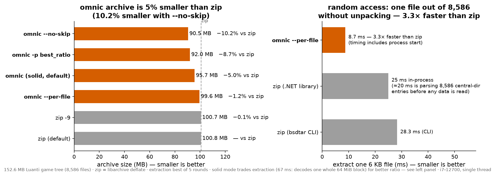
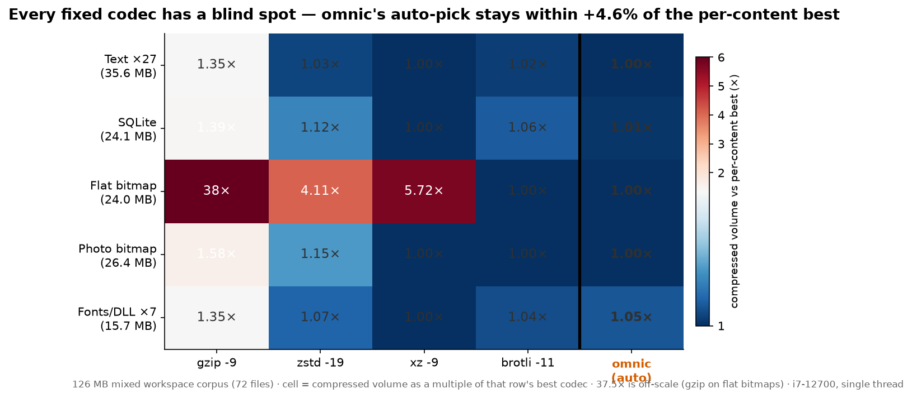
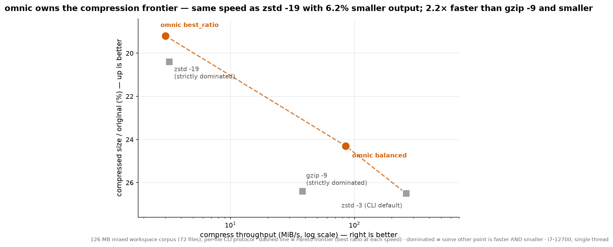
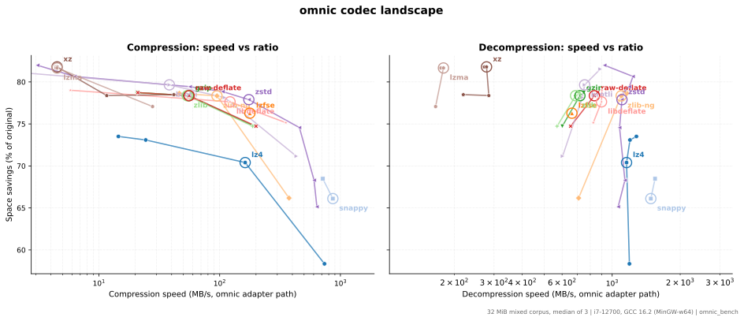

# omnic

**通用压缩器**：识别解压 14 种主流格式，内置 16 个压缩算法；每个文件自动选最合适的算法；目录树打包成单文件，压缩率碾压 zip 全档位。

[English](README.md) | [简体中文](README.zh-CN.md)

[](https://github.com/push-rock/omnic/actions/workflows/ci.yml)

```
$ omnic c report.json
report.json: zstd | balanced | text/code | level 9
    527565 -> 45995 bytes (8.72%), 0.007s, 75.0 MB/s

$ omnic c report.json -p best_ratio
report.json: xz | best_ratio | text/code | level 9
    527565 -> 32108 bytes (6.09%), 0.110s, 4.8 MB/s

$ omnic pack gamedir/
gamedir/: 152644069 -> 100395194 bytes (65.77%), 4.99s
```

## 获取

**Linux / macOS / Windows** 预编译二进制挂在每个 [GitHub Release](https://github.com/push-rock/omnic/releases)，免安装、零运行时依赖。可执行文件在归档内的 `bin/omnic`（Windows 为 `bin\omnic.exe`），放进 `PATH` 即可。

二进制未做代码签名（开源预算）：

- **Windows** —— 从 cmd/PowerShell 调用不受 SmartScreen 影响；双击运行若弹出蓝色警告，选 *更多信息 → 仍要运行*。
- **macOS** —— 终端 `tar -xzf` 解压不会带隔离标记，直接可用；若用双击（归档实用工具）解压，清一次标记：`xattr -d com.apple.quarantine bin/omnic`。

二进制由 CI 在 tag 提交上构建并全量测试后才挂出。从源码构建见 [构建](#构建)。

## 为什么用 omnic

**1. 格式全覆盖，开箱即用。** 内置 16 个 codec、识别解压 14 种格式：gzip（多 member）、zlib、raw deflate、zstd、xz、lzma、lzip、bzip2、lz4、brotli、snappy、compress（.Z）、lzfse、lzvn；其中 12 个 codec 支持压缩（gzip 家族就有三个实现可选）。别人丢给你苹果的 `.lzfse`、1989 年的 `.Z`、一坨裸 deflate 或 Windows 老安装包里的 lzma-alone，omnic 直接开。魔数优先识别，后缀兜底。

**2. 单文件自动选最优算法。** 最优算法随内容而变——文本和数据库该用 xz，扁平图形该用 brotli（相差 4 倍），已压缩资产该存储——omnic 用 ~1 ms 的判定（三段采样 + 8 维特征 + 内容分类）替你每次选对。实测（126 MB 真实混合语料，72 文件）：

- 自动选择的总体积距**理论逐文件最优只差 +1.4%**；固定 `zstd -19` 要多付 7.7%，固定 `brotli -11` 多付 3.2%；
- 6 个内容组 **4 组精确命中最优**，最差一组也只大 4.6%；
- `best_ratio` 与 `zstd -19` 同压缩速度，压出的体积**小 6.2%**；`balanced` 对 `gzip -9` 三轴全胜：**小 8.6%、压缩快 2.2 倍、解压快 2.1 倍**；
- 已压缩资产（PNG/Ogg）直通存储，字节原样、不做无用功。

**3. 打包碾压 zip。** 同一棵 152.6 MB 真实游戏树（8,586 文件）：

- 归档比 zip **小 5.0%**（95.7 vs 100.8 MB），`--no-skip` 极限档**小 10.2%**（90.5 MB）——deflate 全档位的压缩率天花板是 69.2%，omnic 默认档直接压到 **65.8%**；
- 打包比 zip 极限档（-9）**快 1.6 倍**（28.8 vs 18.4 MB/s），与 zip 默认档同档（28.8 vs 38.1）；
- 单文件提取 **8.7 ms，比 zip 快 3.3 倍**（zip CLI 28.3 ms、.NET 库级 25 ms）；全量解包并行写盘（默认 8 worker，`-T` 可调）：本机 Windows Defender 下 4.3 s → 3.9 s——与 zip（2.6 s）的残余差距是杀软对未签名进程新建文件的实时扫描；输出目录加入 Defender 排除或无 AV 环境可获全部提速；
- zip 没有的能力：坏块隔离（一个比特翻转只废一个块，`extracted 7435/8586` 其余照常解出）、`--verify` 无写入全量校验（260 MB/s）、`--list` 不碰数据区列全表（96 ms）；
- `--per-file`（逐文件随机访问）与 solid（整流极限压缩，xz 级 63.2%）一个参数切换；
- 跨语料复核：Silesia 标准基准（202 MiB、12 个混合内容域、文件均无扩展名）上 balanced 依旧双轴全胜——**归档比 zip-deflate 小 10%、打包快 2.1 倍**；`best_ratio` 压到 23.0%（比 zip 低 9.2 pp）。

## 支持的压缩协议

| codec | 格式 | 级别 | 说明 |
|---|---|---|---|
| zstd 1.5.7 | .zst | -5..22 | 支持多线程 |
| lz4 1.10.0 | .lz4 | 0..12 | 级别 0 = fast 模式，1..12 = LZ4HC |
| xz 5.8.4 | .xz | 0..9 | CRC64 校验 |
| zlib 1.3.2 | .gz | 0..9 | 流式编解码，解压支持多 member 拼接 |
| zlib-ng 2.3.3 | .gz | 0..9 | 同格式更快实现，加载模式（zng_ 前缀不冲突） |
| libdeflate 1.26 | .gz | 0..12 | 整块 API，gzip 速度天花板 |
| brotli 1.2.1 | .br | 0..11 | |
| snappy 1.3.1 | .snappy | 1..2 | 官方 framing 格式（magic + CRC32C + 64KB 分块） |
| lzfse 1.0 | .lzfse | — | 唯一速度点 |
| zlib-stream | .zlib | 0..9 | RFC 1950 封装，同一 zlib 库 |
| raw-deflate | .zz | 0..9 | 无头 deflate，按后缀识别；无校验和——损坏流可能静默解出（格式固有） |
| lzma | .lzma | 0..9 | lzma-alone 容器，走 liblzma |
| lzvn | .lzvn | 仅解压 | "bvn" 流，与 lzfse 共用块解码器 |
| lzip | .lz | 仅解压 | lzip 容器（v0/v1），走 liblzma，多 member |
| bzip2 1.0.8 | .bz2 | 仅解压 | 内置解码半边，支持拼接流 |
| compress | .Z | 仅解压 | LZW（ncompress 语义），自包含解码器 |

所有适配器共用一套接口（`src/codec/ac_*.c`），新增算法 = 一个适配器文件 + 一条注册表项。

## 使用方案

```
omnic c   [选项] <文件...>     压缩（默认自动选算法，-c 可指定）
omnic d   [选项] <文件...>     解压（魔数/后缀自动识别格式；.omnic → 整树）
omnic pack   [选项] <目录>     把目录树打包成一个 .omnic 归档
omnic unpack [选项] <归档>     解开 / 列出 / 校验 .omnic 归档
omnic analyze <文件...>        只分析类型/熵/决策，不产生副作用
omnic list                     列出算法与支持的格式

-p --profile <v>   fast_compress | fast_decompress | best_ratio | balanced
-c --codec <名>    指定算法                  -l --level <n>  算法原生级别
-T --threads <n>   线程数（zstd 打包；解包写盘）  -o --output-dir <目录>
-f --force    覆盖已存在输出 / 强制压缩不可压缩数据 / --file 目标已存在
-k --keep     保留源文件（默认：成功后删除）
-x --explain  打印决策依据                   -q --quiet

pack:   --per-file  每文件一块（毫秒级单文件提取，压缩率稍差）
        --no-skip   已压缩资产也压（默认直通存储）
        --block-size <MiB>  solid 块上限，1..1024（默认 64）
unpack: --file <路径>  只提取该条目（可重复）
        --list         只列 名字/大小/算法/压缩率，不碰数据区
        --verify       校验两层 CRC，不写盘
        -C --dir <目录> 输出根目录
```

## 实测结论

所有数字同机实测（i7-12700，单线程，最快轮口径），复现工具随构建自带：`omnic_bench`（codec 级）、`omnic_gamepack`（打包级）。

**结论先行**——每条一个数，出处见下面的表：

1. **打包同一棵 152.6 MB 游戏树，归档比 zip 小 5.0%**（95.7 vs 100.8 MB）；`--no-skip` 极限档 **90.5 MB，小 10.2%**。deflate 无论怎么调档都封顶 69.2%，omnic 默认档 65.8%。
2. **8,586 个条目里提取单个文件，快 3.3 倍**：omnic 8.7 ms，zip CLI 28.3 ms、.NET 库级 25 ms。
3. **逐文件自动选算法，总体积距理论最优只差 +1.4%**（72 文件"天眼"对照）；固定 `zstd -19` 要 +7.7%，固定 `brotli -11` 要 +3.2%。
4. **同压缩速度，比 `zstd -19` 小 6.2%**；对 `gzip -9` 三轴全胜：**小 8.6%、压缩快 2.2 倍、解压快 2.1 倍**。
5. **24 MB 扁平位图压到 744 字节（1/33,000）**——brotli 独门；zstd -19 / xz -9 只能到 3.0 / 4.3 KB。omnic 自动选中 brotli。
6. **固定任何单一算法都有灾难行**：gzip -9 在五个可压缩组每行都至少大 1/3（照片行 +58%）；zstd -19 遇扁平位图大 4.1 倍、xz -9 大 5.7 倍；brotli -11 没有灾难行但全程 1.0 MB/s。omnic 最差一组只大 4.6%。
7. **整流模式解压 1060 MiB/s**（Oodle Kraken-5 公布值的 1.8 倍，估计口径），压缩率最高到 xz 级 57.0%。
8. **跨语料复核——Silesia 标准语料（202 MiB、12 个内容域）：balanced 对 zip-deflate 双轴全胜**：29.0% vs 32.2%，打包 2.4 vs 5.0 s；`best_ratio` 到 23.0%（比 zip 低 9.2 pp）。



### 单文件：最优算法随内容而变，omnic 每次都选对

**没有任何单一算法在所有内容上都是最优。** 126 MB 真实混合语料（72 个文件），按内容分组实测四个极限 codec——每组赢家都不同；omnic 的自动选择（~1 ms/文件）每组都命中或贴住行最优：

| 内容类型 | gzip -9 | zstd -19 | xz -9 | brotli -11 | omnic 自动选择 |
|---|---|---|---|---|---|
| 文本 ×27，35.6 MB | 36.9% | 28.1% | **27.3%** | 27.9% | xz 9 → **27.3%**，命中 |
| SQLite 数据库，24.1 MB | 28.6% | 22.9% | **20.5%** | 21.8% | xz 6 → 20.6%，距最优 +0.6% |
| 合成扁平位图，24.0 MB | 27.9 KB | 3.05 KB | 4.26 KB | **744 B** | brotli 11 → **744 B**，命中（次优是它的 4.1 倍） |
| 照片位图，26.4 MB | 21.8% | 15.8% | **13.8%** | 13.8% | xz 6 → 13.8%，命中 |
| 字体/DLL ×7，15.7 MB | 47.3% | 37.6% | **35.1%** | 36.5% | 逐文件混选 → 36.7%，距最优 +4.6%（全语料最差一组，仍好于固定 zstd -19） |
| 已压缩 PNG/Ogg ×35，0.09 MB | 95.9% | 94.9% | 96.7% | 94.6% | **直通存储**（0 压缩 CPU；固定 codec 磨一遍只换组内 ~5%） |



- **固定任何单一 codec 都有灾难行**：gzip -9 在五个可压缩组每行都至少大 1/3（照片行 +58%）；zstd -19 遇扁平位图大 4.1 倍；xz -9 大 5.7 倍；brotli -11 没有灾难行，但除扁平位图外没有一行最优，且全程 1.0 MB/s（Silesia 实测）。
- **omnic 6 组里 4 组精确命中**，数据库距最优 +0.6%，最差一组 +4.6%。已压缩资产选直通是时间决策——这组在本语料只有 0.09 MB，但在下一节的树里占 82 MB，固定单一 codec 意味着把它们也全磨一遍。
- 整树"天眼"对照：72 个文件每个用四个选项各压一遍、逐文件取最小（理论最优），omnic 的自动选择比它**只大 1.4%**；固定 zstd -19 大 7.7%、固定 brotli -11 大 3.2%；此语料偏文本，恰好轮到固定 xz -9 贴最优（+0.2%）——这正是路由的意义：你不需要知道语料是什么。

**速度位置**——两个主力档位各有一场明确的完胜（同一棵树逐文件口径）：

| 对比 | 体积 | 压缩速度 | 解压速度 | 判定 |
|---|---|---|---|---|
| **balanced** vs `gzip -9` | **小 8.6%** | **快 2.2 倍** | **快 2.1 倍** | **三轴全胜** |
| **best_ratio** vs `zstd -19` | **小 6.2%** | 3.0 vs 3.2 MiB/s，持平 | 188 vs 623 MiB/s，xz 解压代价 | 同压缩速度，**小 6.2%** |
| **balanced** vs `zstd -3`（CLI 默认档） | **小 9.1%** | 85 vs 261 MiB/s，对手快 3.1 倍 | 736 vs 658 MiB/s | 体积小 9.1%，代价是打包慢 3 倍 |



- 决策机制：后缀路由 + 8 维特征细化成 7 个内容类，查表得 `(codec, 级别)`；大文件 `fast_compress` 档在 50 ms 预算内对前两候选实测选优；`--explain` 打印全链路。决策表由 22 分布 × 44 配置基准矩阵拟合，发布过留一 regret 界（ρ ≤ 1.0 pp）。
- codec 级全景（Silesia 212 MiB 标准语料，`omnic_bench` 实测）：



适配层损耗：压缩 ≤0.8% / 解压 ≤1.4%，多数解压路径反而比裸库直调更快（定长分块缓冲的缓存友好性）。

### 打包：同一棵树，对标 zip 全档位

152.6 MB 真实游戏树（Luanti 5.16 + minetest_game + VoxeLibre；8,586 文件——PNG 贴图、Lua 脚本、Ogg 音频、模型、字体、DLL）：

| 方案 | 压缩率 | 归档体积 | vs zip | 打包 | 单文件提取 |
|---|---|---|---|---|---|
| zip（deflate 默认档） | 69.22% | 100.8 MB | — | **3.8 s** | 28.3 ms |
| zip -9（deflate 极限档） | 69.15% | 100.7 MB | -0.1% | 7.9 s | 28.3 ms |
| **omnic pack**（solid 默认） | **65.77%** | **95.7 MB** | **-5.0%** | 5.0 s | 67 ms |
| omnic pack --per-file | 68.4% | 99.6 MB | -1.2% | 8.4 s | **8.7 ms** |
| omnic pack --no-skip | **62.2%** | **90.5 MB** | **-10.2%** | 18.9 s | 67 ms |
| omnic pack -p best_ratio | 63.2% | 92.0 MB | -8.7% | 23.9 s | 67 ms |

- zip 的 deflate 无论怎么调档都封顶 69.2%（-9 多花 2.1 倍时间只换 0.07 pp）；omnic 默认档 65.8%——**小 5.0%**，打包还比 zip -9 快 1.6 倍（吞吐 28.8 vs 18.4 MB/s）。
- 单文件提取：从 8,586 条目里取一个 6 KB Lua 文件，omnic `--per-file` 8.7 ms（含进程启动），zip CLI 28.3 ms、.NET 库级（ZipFile + 流拷贝）25 ms——**快 3.3 倍**；solid 模式 67 ms（读并解开整个 64 MiB 块的代价）。
- 解包墙钟：串行 4.3 s → 默认 8 写盘 worker **3.9 s**（本机 `-T 2` 为 3.6 s）vs 签名 tar.exe 解同内容 zip 2.6 s。分解：无写盘解码+校验 0.56 s vs 0.36 s（deflate 解码本来就快，omnic 多一层块级 CRC——这是坏块隔离能力的代价），其余是建盘——本机大头是 Defender 对未签名进程每个新建文件的实时扫描（同树 robocopy 裸拷贝也要 3.7 s；签名的 tar.exe 分文不付）。把输出目录加入 Defender 排除，或在 Linux/macOS 上跑，并行写盘即兑现全部提速。
- 坏块隔离：每块自带 CRC-32，一个比特翻转只废一个块，提取把块内文件逐个报出后继续（`extracted 7435/8586 files`，退出码 2）。zip 中央目录一坏通常全废。`--list` 只读尾部压缩索引，8,586 条 96 ms。

**跨语料复核：Silesia 标准基准**（12 个域混合文件——小说、词典、化学库、C 源码、医学/X 光影像、二进制、XML；202 MiB；文件均无扩展名，决策全部走内容采样路径）：

| 方案 | 压缩率 | 归档体积 | vs zip | 打包 |
|---|---|---|---|---|
| zip（deflate 默认档） | 32.18% | 65.0 MB | — | 4.96 s |
| omnic `-p fast_compress` | 41.02% | 82.9 MB | +27.5% | **1.08 s** |
| omnic `-p fast_decompress` | 31.37% | 63.4 MB | -2.5% | 1.36 s |
| **omnic pack（默认）** | **28.97%** | **58.6 MB** | **-10.0%** | **2.41 s** |
| omnic `-p best_ratio` | **23.02%** | **46.5 MB** | **-28.5%** | 87.4 s |

- balanced 双轴全胜：**比率小 3.2 pp、打包快 2.1 倍**；fast_decompress 以 3.6 倍速度拿到与 zip 持平的比率；best_ratio 比 zip 低 9.2 pp——归档档位。
- 输面照录：这个大文件语料全量解包 0.83 s vs zip 0.37 s（solid zstd 解码 + 块级 CRC 隔离的代价；上面的并行写盘针对的是多文件树）。10 MB 成员的 `--file` 单提取 48 ms——解码受限；8.7 ms 那条卖点是 6 KB 文件的数字。

**整流极限压缩**（先 tar 再压成单流，lzbench / Oodle 公布口径）：

| 配置 | 压缩率 | 压缩 | 解压 |
|---|---|---|---|
| xz -9（库内压缩率上限） | 56.8% | 3.5 MiB/s | 81 MiB/s |
| **omnic `best_ratio`** → xz 6 | **57.0%** | 3.9 | 79 |
| Oodle Kraken-5* | ~57.8% | — | ~590 |
| zstd -19（Kraken-5 本机代理） | 57.9% | 5.4 | 579 |
| **omnic `balanced`** → zstd 9 | 59.5% | 84 | **652 / 1060†** |
| lz4 -12（速度锚） | 66.0% | 23 | 718 |

`balanced` 整流解压 **1060 MiB/s——Kraken-5 估计值的 1.8 倍**，代价 1.7 pp；`best_ratio` 压缩率反超 Kraken-5 估计值 0.8 pp。没有单一配置能在两个维度同时胜过 Kraken——档位体系就是让你选边。

\* Kraken 无公开二进制，数字为第三方同机实测经机器系数换算的估计（±8%）；zstd-19 在 Silesia 上独立复现了该锚点。
† 同一份压缩数据（产物逐字节相同、走同一次库调用）的两种解压口径：652 MiB/s 把整流驻内存一次性解完——本表其余各行（含 Kraken-5 估计值）所用的 lzbench 式口径；1060 MiB/s 是 omnic 产品实际的流式管线，全程复用 4 MiB 定长缓冲、工作集常驻缓存。两者的全部差异来自缓冲策略。

## 构建

需要 CMake ≥ 3.16 与 C11 编译器（MSVC / GCC / Clang），全部 codec 内置，无系统依赖：

```bash
cmake -B build -DCMAKE_BUILD_TYPE=Release
cmake --build build -j
./build/omnic list
ctest --test-dir build
```

## 许可证

MIT。内置的各算法库保留其原始许可证，见 `THIRD_PARTY_NOTICES.md`。默认不链接任何 GPL/LGPL 代码（`OMNIC_ENABLE_GPL` 预留给可选构建）。
