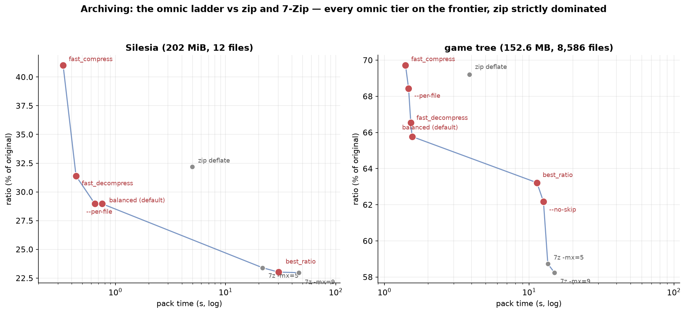
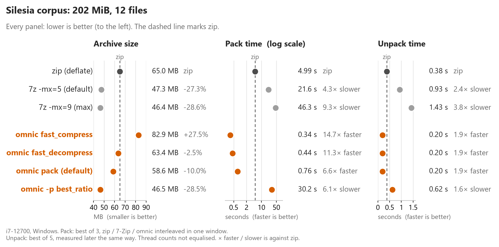
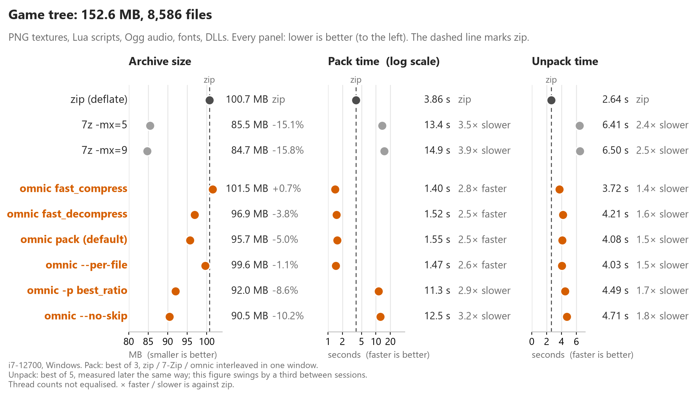
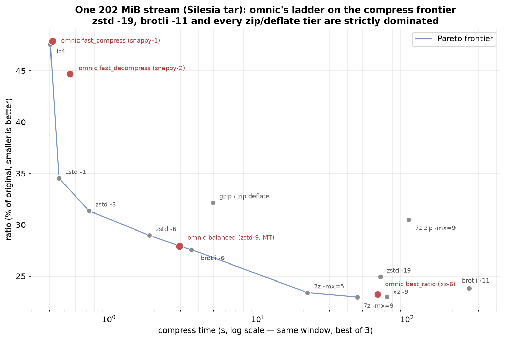
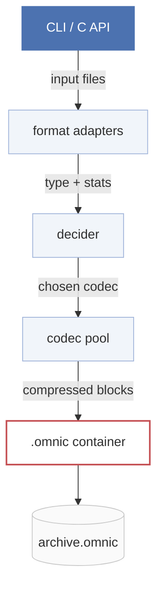

# omnic

**一个二进制，开 14 种压缩格式。** omnic 都能打开；压缩时为每个文件挑对
算法；默认就把整棵目录树打包成比 zip 更小、打得更快的归档——坏一个字节只丢
一个块，而不是整棵树。

[](https://github.com/push-rock/omnic/actions/workflows/ci.yml)
[](https://github.com/push-rock/omnic/releases)
[](LICENSE)

Linux · macOS · Windows——单个静态二进制，零运行时依赖

[English](README.md) | [简体中文](README.zh-CN.md)

[获取](#获取) · [用法](#用法) · [为什么](#为什么用-omnic) · [实测](#实测结果) · [边界](#它还做不到的事) · [codec](#支持的压缩协议) · [幕后](#幕后) · [构建](#构建)

真实输出，有删节：

```console
$ omnic pack gamedir/ -o gamedir.omnic             # 8,586 个文件：PNG、Lua、Ogg、DLL
      block: zstd/6  40812803 -> 8739258 bytes (21.41%)
      block: zstd/9  30225166 -> 9884335 bytes (32.70%)
    gamedir/: 152644069 -> 100395194 bytes (65.77%), 1.55s

$ omnic analyze -x libc++.dll game.lua air.png     # 看它逐文件怎么决定
libc++.dll: executable | entropy 6.43 | -> zstd level 9
game.lua: text/natural | entropy 4.86 | -> zstd level 6
air.png: already compressed | entropy 5.71 | -> skip level 0

$ omnic d xray.lzfse                               # 别的工具打不开的格式
xray.lzfse: lzfse | balanced

$ omnic unpack gamedir.omnic --verify              # 这个归档还完好么？
verified 8586/8586 files, 4 blocks OK
```

## 概览

omnic 的主场是混合内容的目录树——游戏资产、项目文件夹、构建产物：逐文件挑算法，已压缩的直接直通。你的工具不认识的格式，它也能直接开。目前还不支持加密和图形界面，也还不能完整替代 tar（暂不保存符号链接和权限位）——这些都会在后续版本中陆续支持。当前的全部边界见[它还做不到的事](#它还做不到的事)。

- **开 14 种格式。** gzip、zlib、raw deflate、zstd、xz、lzma、lzip、bzip2、
  lz4、brotli、snappy、compress（`.Z`），以及苹果的 lzfse/lzvn。内置
  16 个 codec——其中三个是可互换的 gzip 引擎——12 个既能压也能解。
- **混合目录树打包：比 zip 小，还更快。** 一棵真实的 152.6 MB 游戏树
  （8,586 个文件）：95.7 MB 对 zip 的 100.7 MB，1.55 s 对 3.86 s。
  Silesia 语料上：小 10.0%，打包快 6.6 倍。
- **够得着 7-Zip 的极限压缩率。** `best_ratio` 档在 Silesia 上距
  `7z -mx=9` 在 0.05 个百分点以内，打包快 1.5 倍，解包快 2.3 倍。
- **坏一个字节，损失有上限。** 压法相同的文件压进同一个块（上限
  64 MiB），每个块自带 CRC。一个比特翻转的代价是一个块——仅此而已：
  受影响的文件被点名，其余照常解出。
- **已压缩的文件不白费功夫。** 那棵游戏树里，4,069 个已压缩资产（主要
  是 PNG 和 Ogg）原样直通；CPU 花在压得动的文件上。
- **讲得清自己的判断。** 每个文件约 1 ms 完成分类，`analyze -x` 把类别、
  熵（比特/字节，8 即随机）和选中的 codec 打印出来。



## 获取

**Windows（scoop）**

```console
scoop bucket add omnic https://github.com/push-rock/omnic-bucket
scoop install omnic
```

**Linux、macOS、Windows**——到[最新 Release](https://github.com/push-rock/omnic/releases/latest) 取对应平台的二进制：下载约 1 MB，免安装，零运行时依赖。可执行文件在归档内的 `bin/omnic`（Windows 为 `bin\omnic.exe`），放进 `PATH` 即可。每个版本都由 CI 在 tag 提交上构建并全量测试。想自己构建见[构建](#构建)。

<details>
<summary>二进制未做代码签名</summary>

- **Windows**——从 cmd/PowerShell 调用不受 SmartScreen 影响；双击运行若弹出蓝色警告，选 *更多信息 → 仍要运行*。
- **macOS**——终端 `tar -xzf` 解压不会带隔离标记，直接可用；若用双击（归档实用工具）解压，清一次标记：`xattr -d com.apple.quarantine bin/omnic`。

</details>

## 用法

```console
omnic c notes.txt                                  # 自动选算法 → notes.txt.zst；会替换源文件（同 gzip——加 -k 保留）
omnic d notes.txt.zst                              # 按文件内容识别格式
omnic pack project -o project.omnic                # 速度档：已经比 zip 小
omnic pack project -o project.omnic -p best_ratio  # 压缩率档：归档最小
omnic unpack project.omnic                         # 解到 project.omnic_out/（-C 指定别的目录）
omnic unpack project.omnic --list                  # 名字、大小、codec、压缩率——不碰数据区
omnic unpack project.omnic --file src/main.c       # 只取一个条目（精确路径、目录前缀或 *.ext）
omnic unpack project.omnic --verify                # 这个归档还完好么？不写一个字节。
```

档位是 omnic 要你做的唯一一个选择：

| `-p` | 优化目标 | 倾向选择 |
|---|---|---|
| `fast_compress` | 最短压缩时间 | snappy、zstd `--fast` |
| `fast_decompress` | 最快解压 | snappy、lz4、zstd |
| `balanced`（默认） | 曲线中段 | zstd |
| `best_ratio` | 最小体积 | xz、brotli |

<details>
<summary>完整 <code>omnic --help</code></summary>

```console
omnic - universal compressor (auto-selects the best codec per file type)

usage:
  omnic c   [options] <file...>    compress (auto codec unless -c)
  omnic d   [options] <file...>    decompress (auto format by magic/ext; .omnic archives too)
  omnic pack   [options] <dir>     pack a directory tree into a .omnic archive
  omnic unpack [options] <archive> extract a .omnic archive
  omnic analyze <file...>          show type/entropy/decision without compressing
  omnic list                       list codecs and supported formats
  omnic version | help

options:
  -p, --profile <v>   fast_compress | fast_decompress | best_ratio | balanced (default)
  -c, --codec <name>  force a codec (see: omnic list; overrides skip, not for pack)
  -l, --level <n>     codec-native level
  -T, --threads <n>   worker threads (classify, zstd/xz compress, unpack writers)
  -o, --output-dir <dir>  pack: output archive path; unpack: output dir (same as -C)
  -C, --dir <dir>     unpack: output root directory
  -f, --force         overwrite output; compress incompressible data anyway
  -k, --keep          keep the source file (default: remove after success)
  -x, --explain       print the decision rationale
  -q, --quiet
  --per-file          pack: one block per file (fast single-file extract)
  --no-skip           pack: compress already-compressed assets too
  --block-size <MiB>  pack: solid block limit, 1..1024 (default 64)
  --file <pattern>    unpack: extract entries (exact path, dir/ prefix, or * glob; repeatable)
  --list              unpack: list entries without extracting
  --verify            unpack: verify archive without extracting
```

</details>

## 为什么用 omnic

凡是把自己焊死在一个算法上的归档器，都会继承那个算法的盲区。最优 codec 取决于内容——同一个文件，选对和选错最多差 4 倍——所以 omnic 不选边。

1. **决策即产品。** omnic 对每个文件采样（头、中、尾各 256 KiB），提取
   8 维特征，查一张「类别 × 档位」决策表——表由离线拟合而来，并以留一
   regret 界把关。内容优先于文件名：改了名的 PNG 仍然直通，名叫 `.jpg`
   的文本仍然压缩。你不需要知道自己的数据是什么。
2. **进是标准流，出也是标准流。** omnic 单文件模式写出的是普通的
   gzip、xz、zstd 或 brotli 流，任何工具都能读；别的工具写的，omnic
   都能读。没有任何锁定。
3. **一个为「比 codec 活得更久」而设计的容器。** `.omnic` 归档就是一层
   薄薄的布局：块、索引、两层 CRC。每个块记录产出它的 codec，所以今天
   写下的归档已经能接纳明天才出现的算法——明年解码器变快，你手里已有
   的归档跟着受益。完整格式一页写完：[FORMAT.md](FORMAT.md)。

## 实测结果

同一台机器（i7-12700，12 核 / 20 线程，Windows，NVMe SSD）、同一个测量窗口：7-Zip 26.06、系统 tar（bsdtar，zip/gzip）、以及 omnic 自带库的原生级别（`-c <算法> -l <级别>`），全部与 omnic 在同一会话内交替实测。快档取 3 轮最优（毫秒级提取取 7 轮）。随项目构建的 `omnic_bench` 与 `omnic_gamepack` 复现 omnic 的行；对手行就是各表中标明的原生命令，按其默认设置运行——线程数没有做对齐。压缩率和打包是同一个窗口；**解包**一列是之后用同样的方法另测的一个窗口：整包解到全新目录的墙钟时间，5 轮取最优，各家交替进行。

### 归档：两个语料、全部档位

Silesia（202 MiB，12 个内容域混合文件，均无扩展名——每个决策都走内容采样）：



游戏树（152.6 MB，8,586 个真实文件——Luanti 5.16 + minetest_game + VoxeLibre：PNG 贴图、Lua 脚本、Ogg 音频、模型、字体、DLL）：



- **默认档。** omnic 的默认档是速度档，但它在 Silesia 上仍然比 zip 小
  10%、打包快 6.6 倍——游戏树上小 5.0%、快 2.5 倍。
- **极限档。** `best_ratio` 在 Silesia 上距 `7z -mx=9` 在 0.05 个百分点以内，
  打包还快 1.5 倍：去往同一 codec 的文件放进 solid 块一起压，跨文件冗余
  没有丢。游戏树上 7-Zip 小 5 个百分点——它赢，如实记录。`--no-skip`
  是压缩率冲刺：62.2%。
- **速度一端。** `fast_compress` 是速度档，不是压缩率档：Silesia 上 41%，
  zip 是 32%。输入以已压缩资产为主时它才是对的（游戏树：1.40 s，69.71% 对
  zip 的 69.20%）。
- **提取。** 从 `--per-file` 归档的 8,586 个条目里取一个成员要 8.8 ms
  （zip：26.9 ms）；从 solid 归档取要 54 ms，因为要解开整个块（10 MB 的
  `dickens` 要 104 ms，zip 是 28 ms）。Silesia 全量解包 0.20 s，zip 是
  0.38 s，7-Zip 两档是 0.93–1.43 s；游戏树上是 4.08 s 对 zip 的 2.64 s、7-Zip 两档的
  6.41–6.50 s。`--verify` 以约 1 GB/s 走完两层 CRC、不写一个字节；`--list`
  读 8,586 条 7.5 ms。
- **坏块隔离。** 在那棵游戏树的归档里翻转一个字节：

  ```console
  $ omnic unpack gamedir.omnic              # 这个归档里被翻转了一个字节
  omnic: block 0 (fmt 0) corrupted — skipped, affected: luanti-5.16.1-win64/textures/base/pack/air.png …
  omnic: extracted 7435/8586 files (1151 failed)
  $ echo $?
  2
  ```

  那个块装着 1,151 个文件；其余 7,435 个解出并通过了校验。块有多大——以及
  这与 zip、与 solid 的 `tar.xz` 相比如何——写在[它还做不到的事](#它还做不到的事)里。

<details>
<summary>两张图背后的原始数字</summary>

Silesia（202 MiB）：

| 方案 | 压缩率 | 归档体积 | vs zip | 打包 | 解包 |
|---|---|---|---|---|---|
| zip（deflate，bsdtar） | 32.18% | 65.0 MB | — | 4.99 s | 0.38 s |
| 7z -mx=5（其默认档） | 23.40% | 47.3 MB | -27.3% | 21.6 s | 0.93 s |
| **7z -mx=9（其最大档）** | **22.97%** | 46.4 MB | **-28.6%** | 46.3 s | 1.43 s |
| **omnic fast_compress** | 41.01% | 82.9 MB | +27.5% | **0.34 s** | 0.20 s |
| **omnic fast_decompress** | 31.38% | 63.4 MB | -2.5% | 0.44 s | 0.20 s |
| **omnic pack（默认）** | **28.97%** | **58.6 MB** | **-10.0%** | **0.76 s** | **0.20 s** |
| **omnic -p best_ratio** | **23.02%** | **46.5 MB** | **-28.5%** | **30.2 s** | **0.62 s** |

游戏树（152.6 MB）：

| 方案 | 压缩率 | 归档体积 | vs zip | 打包 | 解包 |
|---|---|---|---|---|---|
| zip（deflate，bsdtar） | 69.20% | 100.7 MB | — | 3.86 s | 2.64 s |
| 7z -mx=5 | 58.73% | 85.5 MB | -15.1% | 13.4 s | 6.41 s |
| **7z -mx=9** | **58.24%** | **84.7 MB** | **-15.8%** | 14.9 s | 6.50 s |
| **omnic fast_compress** | 69.71% | 101.5 MB | +0.7% | **1.40 s** | 3.72 s |
| **omnic fast_decompress** | 66.54% | 96.9 MB | -3.8% | **1.52 s** | 4.21 s |
| **omnic pack（默认）** | **65.77%** | **95.7 MB** | **-5.0%** | **1.55 s** | **4.08 s** |
| **omnic --per-file** | 68.43% | 99.6 MB | -1.1% | **1.47 s** | 4.03 s |
| **omnic -p best_ratio** | 63.22% | 92.0 MB | -8.6% | **11.3 s** | 4.49 s |
| **omnic --no-skip** | **62.17%** | **90.5 MB** | **-10.2%** | 12.5 s | 4.71 s |

</details>

### 单文件与单流

omnic 不带任何新算法：单文件模式只是路由到某个 codec——单文件 `best_ratio` 就是 xz-6，它赢 `zstd -19`，在多数文件上输 `7z -mx=9`。它只在归档上追平 7-Zip：`best_ratio` 在 Silesia 上与 `7z -mx=9` 打平，在游戏树上仍落后 5 个百分点。202 MiB 的 Silesia 语料打成裸 tar，能用上的压缩器全压一遍。X 轴是压缩时间（对数刻度），Y 轴是压缩率——左下角赢：



- **阶梯卡住前沿**：`fast_compress` 在速度端与 lz4 打平，`balanced`（zstd-9，多线程）占据中段，`best_ratio`（xz-6）在压缩率一端顶住 7-Zip 的 LZMA2。
- **著名固定档被严格支配**：zstd -19（比 omnic 的 xz-6 选择*又慢又大*）、brotli -11（260 s——比 best_ratio 慢 4 倍还换不来更好的压缩率）、zip/deflate 全家（比 balanced 又慢又大）。

解压侧，同一批流：


阶梯在解压侧同样站得住——快档是 snappy 级解压（1.1 GB/s，与 lz4 打平），balanced 是 zstd 级，压缩率一端是 xz 级。单流的压缩率竞赛仍是 `7z -mx=9` 和 `xz -9` 赢。两张图背后的 16 配置对照表、逐文件对标 zip 全档的结果，以及与 Kraken 的对比，都在 [BENCHMARK.md](BENCHMARK.md)。

## 它还做不到的事

截至 v0.3.3 的边界——把它用于备份之前请先读这一节。

- **还不是完整的 tar 替代品。** v1 不保存符号链接和 POSIX 权限位（格式已为
  两者预留了位置），也没有 `--exclude`；这三项和加密都排在后续版本。7-Zip 的
  格式广度和 25 年成熟度，omnic 目前确实还没有。
- **它不开 zip、7z、rar 归档。** 那 14 种是单流压缩格式；omnic 自己读写
  的归档是 `.omnic`。
- **每个归档最多 65,535 个条目。** v1 格式上限；更大的目录树 `pack` 会
  当场拒绝。
- **索引只有一份，在文件尾部。** 被截断或尾部损坏的归档会被整体拒绝——
  隔离只覆盖数据块内部的损坏。
- **爆炸半径是一个块，而块可能很大。** 块上限 64 MiB（`--block-size
  1..1024`），对小文件成堆的目录树就是几千个文件：上面那个归档里，最大的
  一个块装着 4,233 个文件。公道地说：zip 只丢受损坏的那一个文件，而单流
  的 `tar.xz` 或 solid 的 7z 会丢掉坏字节之后的一切。omnic 居中，粒度
  是块——而块大小由你定。`--per-file` 让每个*被压缩的*文件独占一块；
  已压缩文件仍共享 store 块，所以在意爆炸半径时把 `--block-size` 也调小。
- **单流仍然压得更狠。** `tar | xz -9` 在游戏树上到 56.8%（v0.3.3 窗口），
  `best_ratio` 是 63.2%——代价是放弃逐文件路由、直通和毫秒级单文件提取。
- **Windows 上解包大量小文件比 tar 慢**：8,586 个文件的树，首次测量是
  3.2 s 对 1.8 s，图背后的那个窗口里是 4.08 s 对 2.64 s——这个数字在不同
  会话之间会摆动三成。其中引擎只占 0.12 s；其余是建文件，大头是 Defender
  对未签名进程写的每个文件逐个扫描（同一棵树裸 robocopy 也要 3.7 s，后一
  个窗口里是 3.9 s）。把输出目录加入 Defender 排除后降到约 1.8 s。Linux
  和 macOS 没有这笔税。
- **有些格式离不开扩展名。** brotli 和 raw deflate 本身没有魔数；snappy
  和 lzfse 目前靠扩展名匹配。

## 支持的压缩协议

16 个 codec，共用一套适配器接口（`src/codec/ac_*.c`）——新增一个 = 一个适配器文件 + 一条注册表项。

<details>
<summary>codec 表——版本、扩展名、级别</summary>

| codec | 格式 | 级别 | 说明 |
|---|---|---|---|
| zstd 1.5.7 | .zst | -5..22 | 支持多线程 |
| lz4 1.10.0 | .lz4 | 0..12 | 级别 0 = fast 模式，1..12 = LZ4HC |
| xz 5.8.4 | .xz | 0..9 | CRC64 校验；`-T` 多线程 |
| zlib 1.3.2 | .gz | 0..9 | 流式编解码，解压支持多 member 拼接 |
| zlib-ng 2.3.3 | .gz | 0..9 | 同格式更快实现 |
| libdeflate 1.26 | .gz | 0..12 | 整块 API，gzip 速度天花板 |
| brotli 1.2.1 | .br | 0..11 | |
| snappy 1.3.1 | .snappy | 1..2 | 官方 framing 格式（magic + CRC32C + 64KB 分块） |
| lzfse 1.0 | .lzfse | — | 唯一速度点 |
| zlib-stream | .zlib | 0..9 | RFC 1950 封装，同一 zlib 库 |
| raw-deflate | .zz | 0..9 | 无头 deflate，按后缀识别；无校验和——损坏流可能静默解出（格式固有） |
| lzma | .lzma | 0..9 | lzma-alone 容器，走 liblzma |
| lzvn | .lzvn | 仅解压 | "bvn" 流，与 lzfse 共用块解码器 |
| lzip | .lz | 仅解压 | lzip 容器（v0/v1），走 liblzma，多 member |
| bzip2 1.0.8 | .bz2 | 仅解压 | 内置解码半边，支持拼接流 |
| compress | .Z | 仅解压 | LZW（ncompress 语义），自包含解码器 |

</details>

## 幕后

pack 路径是一条流水线：识别每个文件、为它选 codec、压缩、写出自带 CRC 校验的块。

- **构造上就是确定性的。** 并行与串行产物逐字节相同——`-T 1` 等于 `-T 8`，有 CI 测试把关。
- **该并行的地方才并行。** 分类池遍历目录树，worker 池压缩块，解码池跑在提取前面，写盘池负责落盘。整棵代码树在 CI 上过 ThreadSanitizer 无竞态。
- **小到读得完。** C11，16 个 codec 全部 vendored、静态链接；引擎、决策器和 CLI 加起来约 7,000 行。
- **规范才是契约。** [FORMAT.md](FORMAT.md) 是 `.omnic` 的字节级定义——足以据此写出独立的解码器。

<details>
<summary>pack 流水线</summary>



**格式适配层**识别每个文件——magic 字节优先、文件扩展名兜底；**决策器**在约 1 ms 内为每个文件选 codec；**codec 池**用 16 个内置 codec 压缩；**.omnic 容器**写块、索引与双重 CRC。`d` / `unpack` 沿同一条流水线反向执行。

</details>

## 构建

需要 CMake ≥ 3.16 与 C11 编译器（MSVC / GCC / Clang）。全部 codec 内置，无系统依赖。

```bash
cmake -B build -DCMAKE_BUILD_TYPE=Release
cmake --build build -j
./build/omnic list
ctest --test-dir build
```

## 许可证

MIT。内置 codec 保留各自许可，见 `THIRD_PARTY_NOTICES.md`。默认不链接任何 GPL/LGPL 代码（`OMNIC_ENABLE_GPL` 留给可选构建）。
